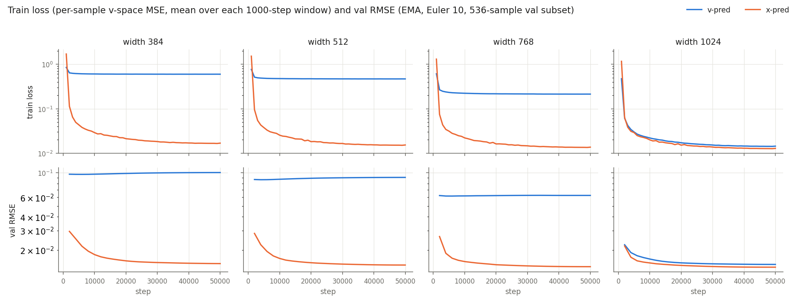
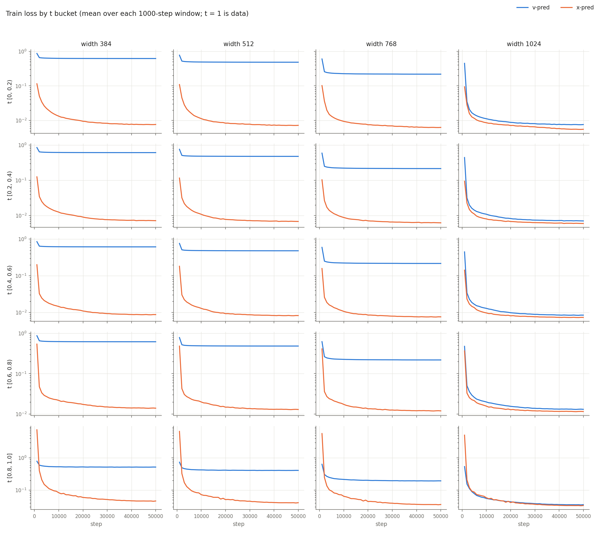
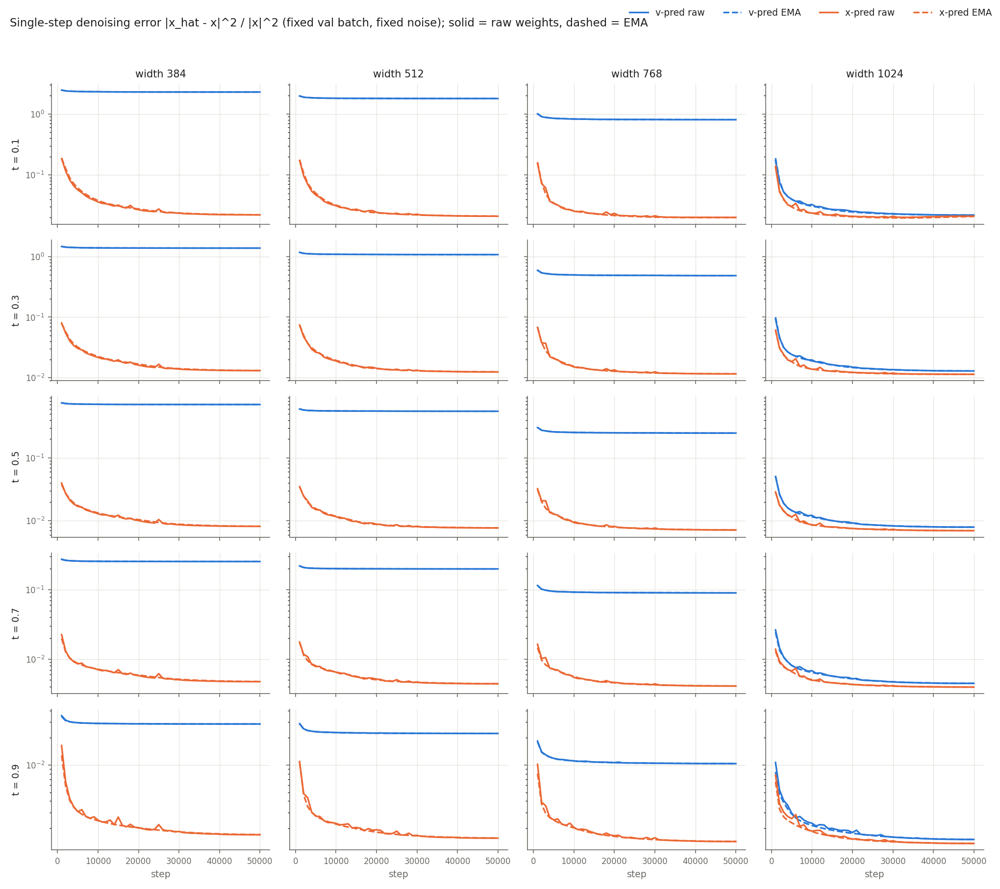
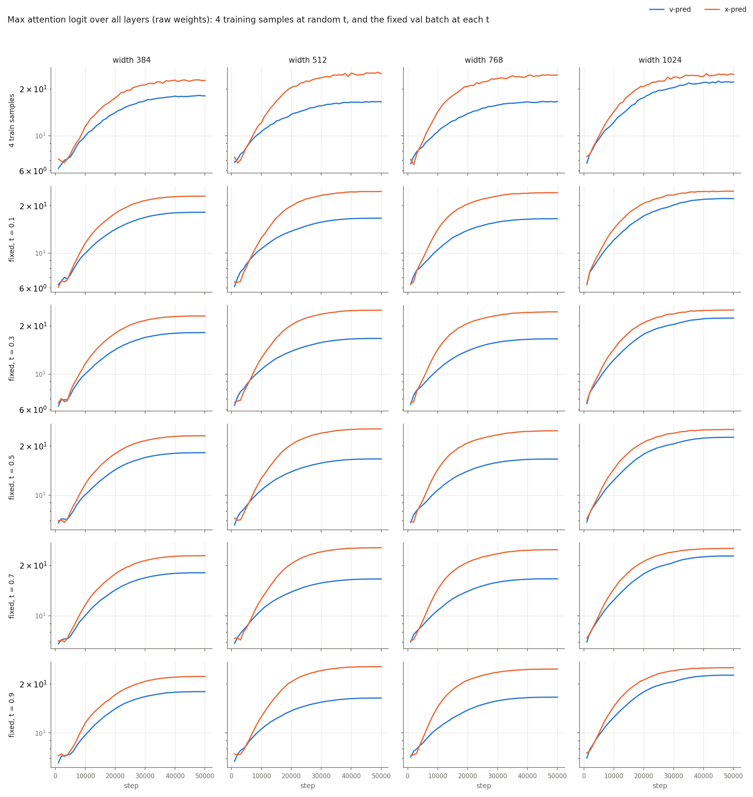
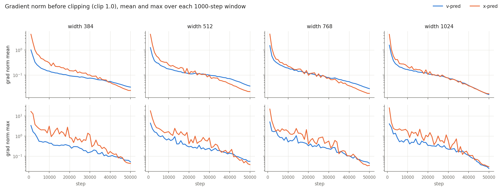
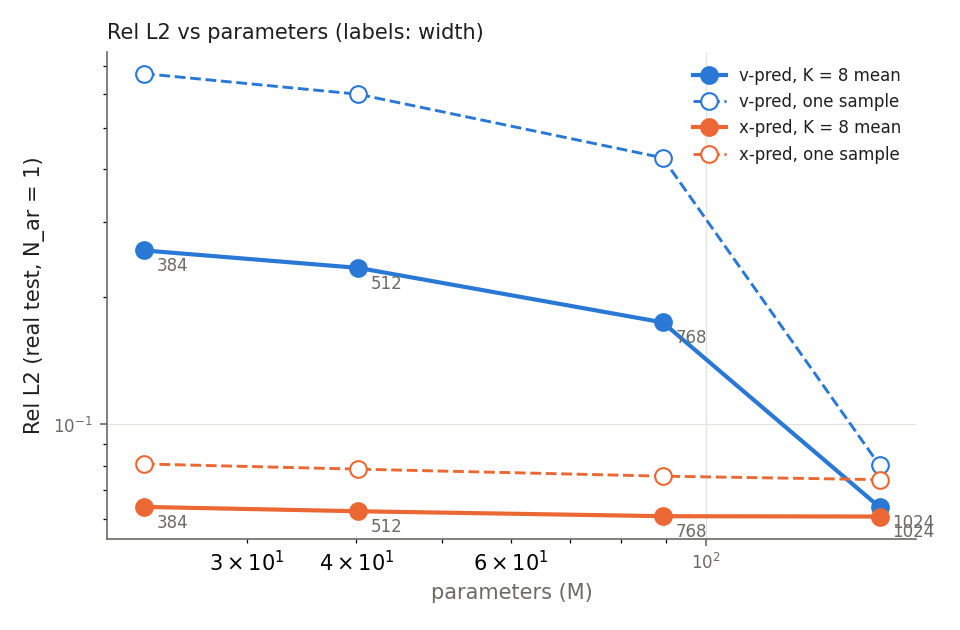
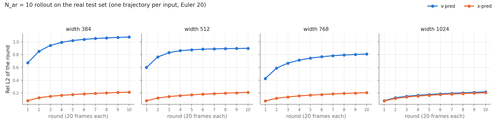
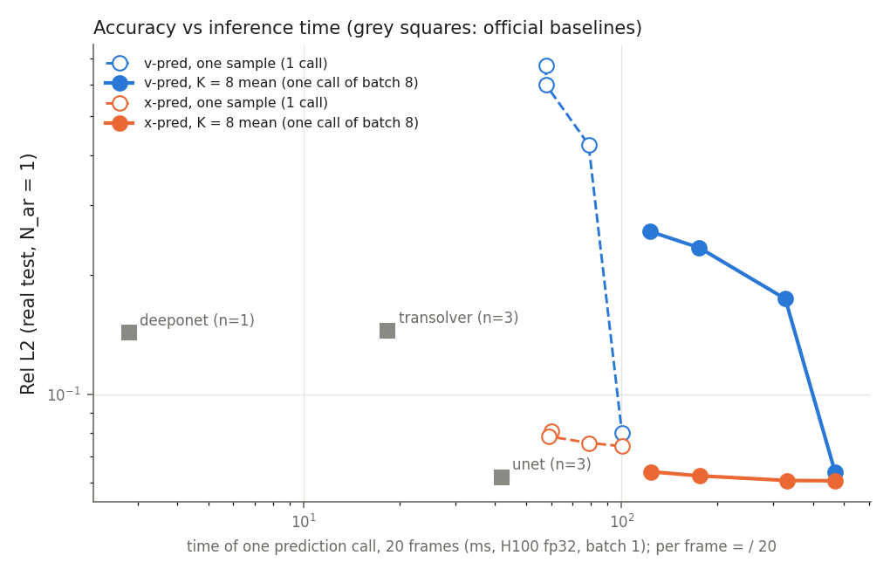
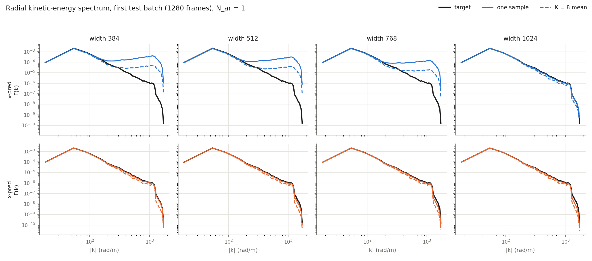

# DiT 預測目標（x vs v）× 模型寬度：結果總整

日期：2026-10-28。任務：[TASK_2026-10-26_dit-xpred-width.md](TASK_2026-10-26_dit-xpred-width.md)。決策紀錄：[../../DECISIONS.md](../../DECISIONS.md)（D1–D39）。

本文件只整理數字與觀察到的現象，不下研究結論。

狀態：Step 0–6 完成。Step 7（瓶頸 patch embedding）不做（D37）。

---

## 1. 設定

| 項目 | 設定 |
|---|---|
| 資料 | RealPDEBench cylinder v2.0.1，real 資料（D16）；輸入 20 幀、輸出 20 幀，64×128，3 通道 |
| 模型 | DiT，patch 4（輸出 token 維度 60·4² = 960），depth 8，head dim 64，QK-norm（D19） |
| 網格 | v-pred R1–R4、x-pred R5–R8；width 384 / 512 / 768 / 1024（heads 6 / 8 / 12 / 16） |
| loss | 兩種參數化都在 v 空間算 loss；x-pred 換算 v = (x̂ − y_t) / max(1 − t, 0.05)，target 用同一個分母（D3、D4、D18） |
| 訓練 | 50k 步 × global batch 64，AdamW lr 1e-4，warmup 1000 + cosine，seed 0，所有寬度同一組超參數（D6、D16） |
| checkpoint | 每 2000 步在 536 筆 real val 子集上算 EMA 權重的 RMSE（Euler 10、K = 1），取最小（D13）；不使用 test |
| 評估 | real test，官方評估流程（`pilfm/official_eval`）；Euler 20 |
| 單步（N_ar = 1） | 4827 筆，每筆 K = 8 個樣本；報第 1 個樣本（「單一樣本」）與 8 個的平均（「K = 8 平均」）（D9、D34） |
| rollout（N_ar = 10） | 4672 筆，每筆 1 條軌跡（K = 1），metric batch 64（D35、D36） |
| 硬體 | Nano5 H100；訓練每個 run 1 張 GPU（D29） |

## 2. 成本（Step 2，H100 bf16，單次 forward）

| run | width | 參數量 | GFLOPs (b1) | ms (b1) | ms (b64) | samples/s (b64) |
|---|---|---|---|---|---|---|
| R1 v | 384 | 22.93M | 18.9 | 4.51 | 17.7 | 3617 |
| R2 v | 512 | 40.21M | 31.6 | 4.50 | 22.9 | 2799 |
| R3 v | 768 | 89.21M | 66.8 | 4.50 | 34.1 | 1874 |
| R4 v | 1024 | 157.48M | 114.8 | 4.51 | 46.2 | 1385 |
| R5 x | 384 | 22.93M | 18.9 | 4.60 | 18.1 | 3545 |
| R6 x | 512 | 40.21M | 31.6 | 4.57 | 23.2 | 2757 |
| R7 x | 768 | 89.21M | 66.8 | 4.56 | 34.5 | 1856 |
| R8 x | 1024 | 157.48M | 114.8 | 4.57 | 46.6 | 1375 |

- batch 1 的時間在 4 個寬度都約 4.5 ms；batch 64 隨寬度增加（D24）。

## 3. 訓練（Step 5）

| run | 最後 train loss（窗口平均） | val RMSE @50k | 最佳 val RMSE | 最佳點 | it/s | 最大 grad norm | 最大 attention logit（訓練樣本） | NaN/Inf |
|---|---|---|---|---|---|---|---|---|
| R1 v 384 | 0.596 | 0.1006 | 0.0968 | 6k | 10.6 | 3.4 | 18.2 | 0 |
| R2 v 512 | 0.467 | 0.0909 | 0.0867 | 4k | 10.8 | 4.4 | 16.6 | 0 |
| R3 v 768 | 0.213 | 0.0625 | 0.0617 | 6k | 9.3 | 5.1 | 16.6 | 0 |
| R4 v 1024 | 0.0144 | 0.01484 | 0.01484 | 50k | 7.0 | 4.1 | 22.4 | 0 |
| R5 x 384 | 0.0169 | 0.01510 | 0.01510 | 50k | 10.4 | 16.8 | 22.8 | 0 |
| R6 x 512 | 0.0153 | 0.01465 | 0.01465 | 50k | 10.4 | 18.2 | 25.5 | 0 |
| R7 x 768 | 0.0137 | 0.01415 | 0.01415 | 50k | 9.3 | 22.3 | 24.6 | 0 |
| R8 x 1024 | 0.0128 | 0.01401 | 0.01401 | 50k | 6.9 | 25.3 | 25.0 | 0 |

- 8 個 run 都跑滿 50k 步，沒有出現 NaN/Inf，牆鐘時間 1:23–2:22。
- R6 的最佳 val RMSE 0.01465，與先前 C2 的同設定（x-pred、patch 4、QK-norm、width 512）0.01462–0.01467 相同。
- R1–R3 的最佳點在 4k–6k 步，之後 val RMSE 上升；Step 6 用的是這些早期 checkpoint（D13、D38）。

## 4. 評估（Step 6）

逐 run 的完整數字（含 Step 2 成本欄位、13 項指標、每一輪 Rel L2、計時）：[dit_xpred_width.csv](dit_xpred_width.csv)。

### 4.1 單步（N_ar = 1，K = 8）

| run | Rel L2 單一樣本 | Rel L2 K=8 平均 | RMSE 單一樣本 | RMSE K=8 平均 | R² 單一樣本 | R² K=8 平均 | CRPS | spread (rms) |
|---|---|---|---|---|---|---|---|---|
| R1 v 384 | 0.6707 | 0.2570 | 0.0969 | 0.0380 | −1.493 | 0.616 | 0.0233 | 0.0953 |
| R2 v 512 | 0.5998 | 0.2338 | 0.0867 | 0.0348 | −0.997 | 0.679 | 0.0210 | 0.0849 |
| R3 v 768 | 0.4249 | 0.1740 | 0.0618 | 0.0264 | −0.013 | 0.815 | 0.0153 | 0.0597 |
| R4 v 1024 | 0.0801 | 0.0638 | 0.01552 | 0.01246 | 0.936 | 0.959 | 0.00355 | 0.0099 |
| R5 x 384 | 0.0807 | 0.0639 | 0.01568 | 0.01249 | 0.935 | 0.959 | 0.00357 | 0.0101 |
| R6 x 512 | 0.0785 | 0.0625 | 0.01528 | 0.01223 | 0.938 | 0.960 | 0.00347 | 0.0098 |
| R7 x 768 | 0.0755 | 0.0608 | 0.01473 | 0.01196 | 0.942 | 0.962 | 0.00336 | 0.0092 |
| R8 x 1024 | 0.0741 | 0.0607 | 0.01444 | 0.01200 | 0.945 | 0.962 | 0.00336 | 0.0086 |

物理量指標（K = 8 平均；單一樣本的值在 CSV）：

| run | KE error | F error | freq error |
|---|---|---|---|
| R1 v 384 | 0.00107 | 0.00214 | 47.5 |
| R2 v 512 | 0.00087 | 0.00212 | 48.4 |
| R3 v 768 | 0.00047 | 0.00189 | 41.3 |
| R4 v 1024 | 0.000132 | 0.00143 | 29.0 |
| R5 x 384 | 0.000133 | 0.00144 | 28.9 |
| R6 x 512 | 0.000130 | 0.00140 | 28.1 |
| R7 x 768 | 0.000125 | 0.00137 | 27.7 |
| R8 x 1024 | 0.000124 | 0.00138 | 27.7 |

官方 baseline（Phase 4，real test，N_ar = 1，各 seed 平均）：U-Net 0.0620（3 seeds）、DeepONet 0.1429（1 seed）、Transolver 0.1449（3 seeds）。

### 4.2 散度殘差（N_ar = 1）

> **與 D17 不一致，待確認。** D17 決定這輪不做散度評估；Step 6 依 D32 計算了，但當時沒有指出和 D17 的衝突。數字先列在這裡，是否保留由使用者決定。

定義與參數依 D32：div_rel = ‖∂u/∂x + ∂v/∂y‖₂ / (‖∂u/∂x‖₂ + ‖∂v/∂y‖₂)；real 格距（dx ≈ 2.536 mm、dy ≈ 2.730 mm），v 不翻號，Ω 沿用 CLFT Phase 1（去掉邊界 4 格、障礙物與 PIV 無效格點）。表中為所有幀的中位數；test 真值本身是 0.681。

| run | 單一樣本 | K = 8 平均 |
|---|---|---|
| R1 v 384 | 0.713 | 0.702 |
| R2 v 512 | 0.713 | 0.699 |
| R3 v 768 | 0.706 | 0.688 |
| R4 v 1024 | 0.678 | 0.657 |
| R5 x 384 | 0.679 | 0.657 |
| R6 x 512 | 0.679 | 0.658 |
| R7 x 768 | 0.677 | 0.658 |
| R8 x 1024 | 0.677 | 0.659 |

### 4.3 rollout（N_ar = 10，K = 1）

| run | 整體 Rel L2 | 整體 RMSE | 第 1 輪 | 第 5 輪 | 第 10 輪 |
|---|---|---|---|---|---|
| R1 v 384 | 0.984 | 0.1432 | 0.671 | 1.019 | 1.074 |
| R2 v 512 | 0.843 | 0.1233 | 0.600 | 0.875 | 0.897 |
| R3 v 768 | 0.718 | 0.1051 | 0.425 | 0.743 | 0.808 |
| R4 v 1024 | 0.176 | 0.0322 | 0.080 | 0.177 | 0.217 |
| R5 x 384 | 0.174 | 0.0319 | 0.081 | 0.174 | 0.213 |
| R6 x 512 | 0.170 | 0.0313 | 0.078 | 0.169 | 0.209 |
| R7 x 768 | 0.166 | 0.0306 | 0.076 | 0.165 | 0.205 |
| R8 x 1024 | 0.164 | 0.0303 | 0.074 | 0.164 | 0.203 |

- 每輪 20 幀；每一輪的數字見 CSV（`nar10_rel_l2_round1`–`round10`）。
- baseline 沒有跑 N_ar = 10（D35）。

### 4.4 推論時間（H100 fp32）

計時用 fp32（評估時的精度）、CUDA events；「一次呼叫」= 一次預測 20 幀 = 單次 forward × NFE 20（D31）。每幀時間 = 一次呼叫 ÷ 20。

| 模型 | 一次呼叫 b1 (ms) | 每幀 b1 (ms) | b64 每樣本 (ms) | K = 8 一次呼叫 (ms) | 10 輪 rollout b1 (ms) |
|---|---|---|---|---|---|
| R1 v 384 | 57.8 | 2.89 | 12.3 | 123 | 574 |
| R2 v 512 | 57.9 | 2.89 | 18.8 | 176 | 574 |
| R3 v 768 | 78.8 | 3.94 | 35.0 | 328 | 779 |
| R4 v 1024 | 100.3 | 5.01 | 57.4 | 470 | 994 |
| R5 x 384 | 60.1 | 3.01 | 12.4 | 124 | 594 |
| R6 x 512 | 59.0 | 2.95 | 18.9 | 176 | 586 |
| R7 x 768 | 79.2 | 3.96 | 35.3 | 332 | 789 |
| R8 x 1024 | 100.4 | 5.02 | 57.6 | 469 | 994 |
| U-Net | 41.8 | 2.09 | 22.1 | — | 419 |
| DeepONet | 2.81 | 0.14 | 2.06 | — | 31.9 |
| Transolver | 18.4 | 0.92 | OOM | — | 184 |

- baseline 用隨機權重、合成輸入計時（只量時間，D33）。
- Transolver 在 fp32 batch 64 OOM；在它自己的 test batch 16 下是每樣本 13.1 ms。U-Net 在 test batch 12 下是每樣本 23.4 ms。

### 4.5 徑向動能譜（N_ar = 1，第一個 test batch，1280 幀）

- R1–R3 的單一樣本在 |k| ≳ 200 rad/m 時高於 test 真值約 1–2 個數量級；K = 8 平均較低，但仍高於真值。
- R4、R5–R8 的單一樣本與真值重疊；K = 8 平均在高波數略低於真值。

## 5. 驗證

- 新評估腳本 `scripts/eval_xpred_width.py` 在 R6 上與既有程式逐位元比對（S6a）：
  - N_ar = 1、K = 2 的 13 項指標、CRPS、spread 與 `eval_prob.py` 相同。
  - N_ar = 10、K = 1（128 筆）的指標與官方 `run_test` 相同。
- 正式評估中 R6 的 N_ar = 10 整體 Rel L2 0.1703，與 S6a 的 `run_test` 參考值 0.1702806 一致。
- Ω 由 CLFT `run_E.geometry` 產生，8 個 sim 抽查：幀差 0.0、div_rel 差 2.7e-15。

## 6. 限制與注意事項

- 每個設定只有 1 個 seed。
- 所有寬度用同一組 LR 與 schedule（D6）；較寬模型的最佳 LR 可能不同。
- R1–R3 的 test 數字來自 val 選出的 4k–6k 步 checkpoint，不是 50k 步的模型（D38）。
- rollout 只有 1 條軌跡，沒有 spread（D36）。
- DeepONet baseline 只有 1 個 seed。
- 能譜只用第一個 test batch（1280 幀）。
- Step 2 的成本是 bf16，Step 6 的計時是 fp32，兩者不能直接相比。
- 散度那一節與 D17 不一致，見 4.2。

## 7. 算力

| 項目 | GPU-h（H100） |
|---|---|
| Step 5 訓練（8 個 run） | 約 13.9 |
| Step 6 評估（8 個 run） | 約 7.3 |
| Step 6 計時 | 0.2 |

## 8. 檔案位置

結果根目錄：`/work/b314513067/pi-lfm/results/fm/2026-10-26_dit-xpred-width/`

| 子目錄 | 內容 |
|---|---|
| `S1_pred-switch-check/`、`S1b_data-sha256-check/` | Step 1 的參數化開關測試、資料雜湊核對 |
| `S2_width-cost/` | 成本表 |
| `S3a_real-cache-build/`、`S3_diag-logging/`、`S3b_diag-decisions-D26/` | real cache 重建、訓練診斷的測試 |
| `S4_smoke-200it/`、`S4b_periodic-ckpt/` | smoke test |
| `S5_train-50k/` | 8 個 run（checkpoint、log、`code_snapshot/`、`figures_diag-curves/`） |
| `S6a_eval-validation/` | 評估腳本的驗證 |
| `S6_eval-test/` | `eval/`（每 run 2 個 JSON）、`bench/`、`summary/`（CSV、圖）、送出時的程式碼狀態 |

程式：`scripts/bench_xpred_width.py`（Step 2）、`scripts/plot_xpred_width.py`（Step 5 圖）、`scripts/xpred_width_omega.py`、`scripts/eval_xpred_width.py`、`scripts/summarize_xpred_width.py`（Step 6）；config 在 `fm/configs/cylinder/xpred_width/`。
