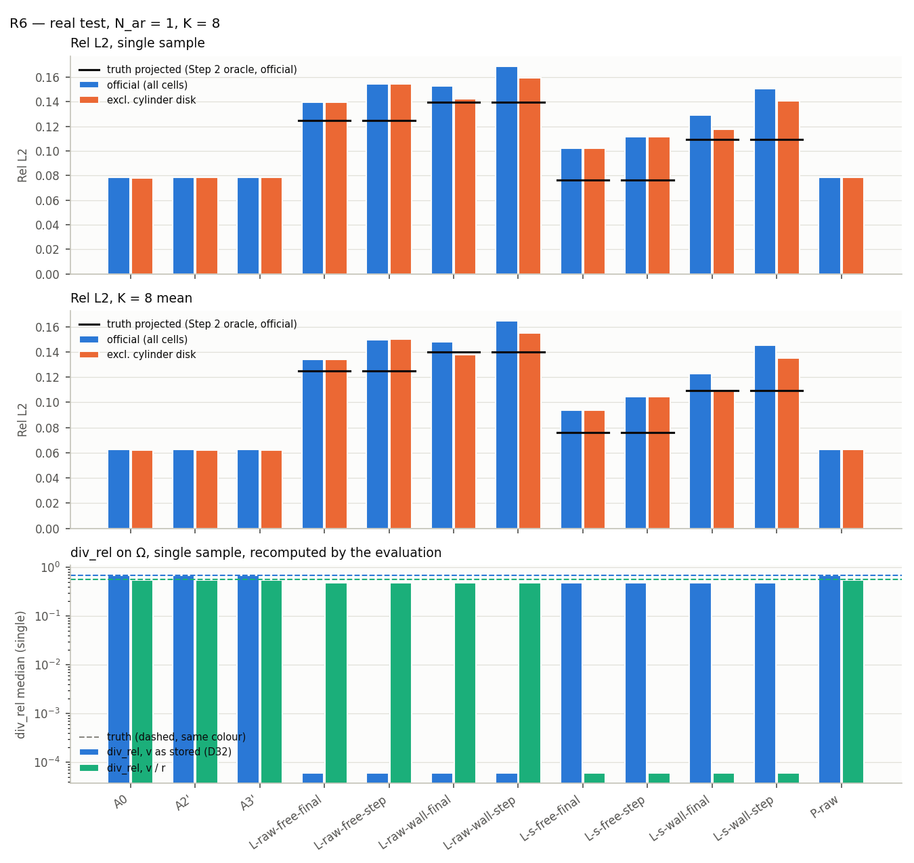
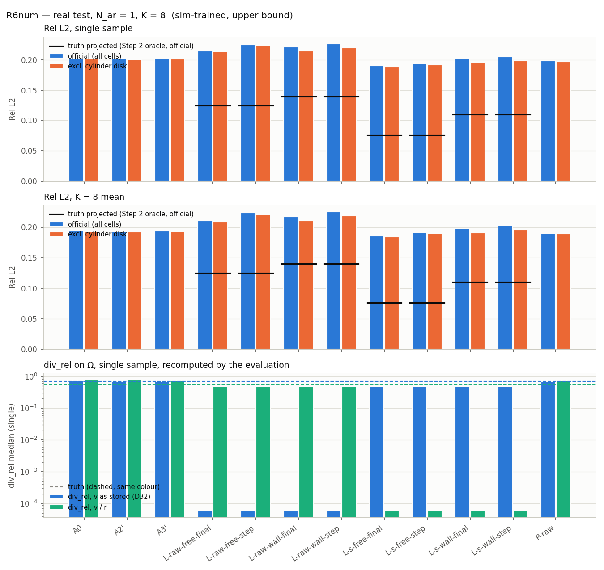
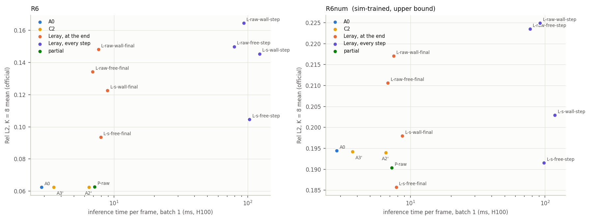
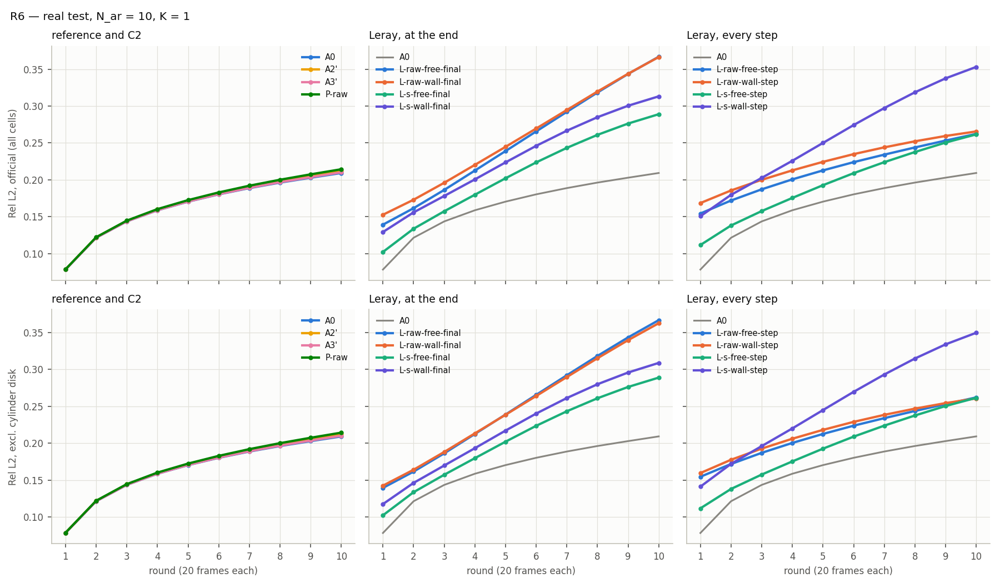
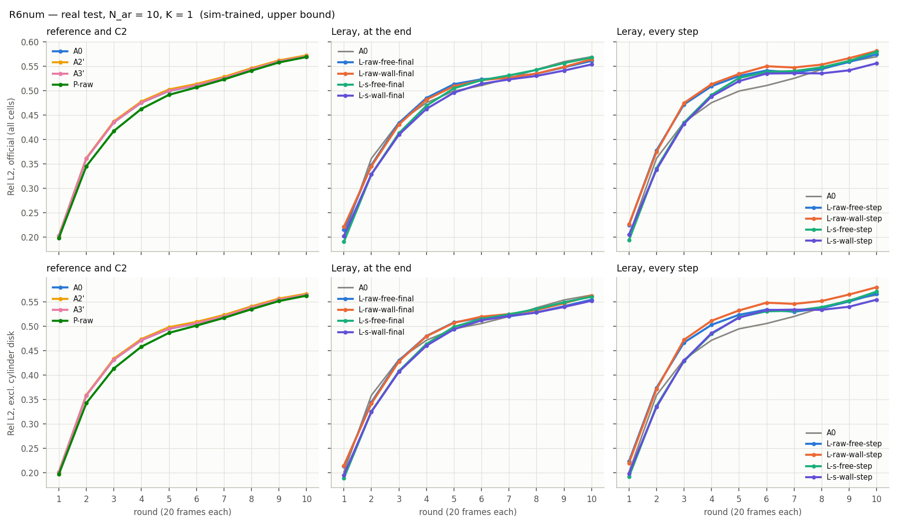
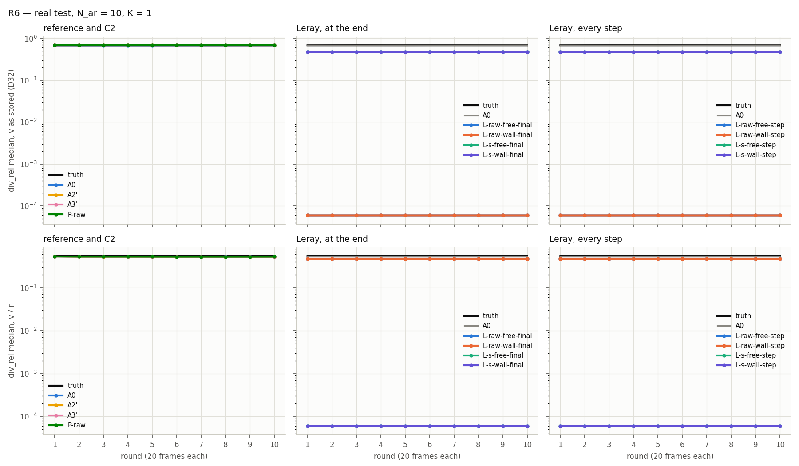
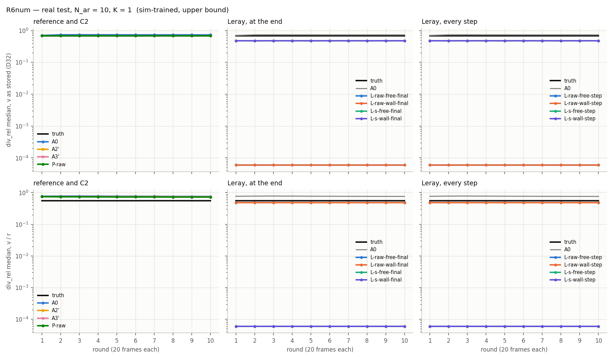

# Leray 投影（散度為 0）作為推論期硬約束的對照組：結果總整

日期：2026-11-24。任務：[TASK_2026-11-22_leray-xpred.md](TASK_2026-11-22_leray-xpred.md)。決策紀錄：[DECISIONS.md](DECISIONS.md)（L1–L32）。前一個實驗（PCFM、約束 C2）：[../pcfm_xpred/RESULTS_2026-11-09_pcfm-xpred.md](../pcfm_xpred/RESULTS_2026-11-09_pcfm-xpred.md)。

本文件只整理數字與觀察到的現象，不下研究結論。

狀態：Step 0–5 完成。只做推論，沒有訓練。結果檔在 `/work/b314513067/pi-lfm/results/fm/2026-11-22_leray-xpred/S{0..5}_*/`（不在 repo 內）。

---

## 1. 設定

| 項目 | 設定 |
|---|---|
| 模型 | R6：real 資料訓練的 x-pred DiT（`best.pt` step 50000，EMA）；R6num：只用模擬資料訓練（`best.pt` step 4000，以 real val 選點，數字屬上限）（L9、L14） |
| 約束 | 每個輸出幀的速度場逐點散度為 0（D32 中央差分，在約束區內），以 Leray 投影求「改動最小、滿足約束」的速度場：解 $(DD^\top)\varphi = D\mathbf{u}$、$\mathbf{u}\leftarrow\mathbf{u}-D^\top\varphi$，矩陣自由 CG、fp64、相對容忍值 1e-10、上限 5000 次（L1、L11、L25） |
| 投影所在的單位 | 存檔的物理單位：反正規化 → 投影 → 再正規化；壓力通道不動（L11） |
| 取樣 | Euler 20 步；約束組用「外推 → 反推噪聲退回」，不加約束時與 Euler 相同（L3） |
| 噪聲 | test seed 1234，val seed 0；同一筆樣本在各組的初始噪聲相同（L10） |
| 評估 | real test，官方評估流程，fp32；單步（N_ar = 1）：4827 筆、每筆 K = 8；10 輪（N_ar = 10，每輪 20 幀，共 200 幀）：4672 筆、K = 1（L10、L12） |

### 1.1 組別

| 代號 | 內容 |
|---|---|
| A0 | 原本的 Euler，不加約束 |
| A2' | 約束 C2（每幀 div_rel 等於目標值 τ，τ = 該樣本真實輸入最後一幀的 div_rel），每一步投影，最後再投影一次 |
| A3' | 約束 C2，只在最後投影 |
| L-{raw,s}-{free,wall}-{final,step} | Leray 投影的 8 組（L4）： |
| 　raw / s | 散度算子的 v 尺度：raw = 存檔的 v；s = v 乘以 1/r（r 為每條 trajectory 的 v/u 尺度估計，約 2.82–2.85，同既有「v/r」評估變體）（L6） |
| 　free / wall | free：約束區 = Ω；wall：圓柱本體（幾何圓盤，半徑 D/2）的 u、v 固定為 0，約束區擴大為 Ω_wall（Ω 加上圓柱周圍膨脹環中的流體格點）（L7、L17） |
| 　final / step | final：只在最後投影一次；step：每一步都投影，最後再投影一次 |
| P-raw | 部分投影：沿 raw-free 的 Leray 方向只走一部分（比例 α，以二分法求），讓 div_rel 等於 τ；只在最後做（L4、L21） |

### 1.2 評估指標

- Rel L2：官方算法（全網格），以及「排除圓柱本體」（主要報告，L20）、「排除膨脹障礙物」、strict Ω，各有 v/r 版本（L8）。完整數字在 CSV。
- div_rel：在 Ω 內的相對散度，分兩種尺度報：存檔尺度（D32）與 v/r 尺度。
- 約束殘差：Leray 組報評估時重算的最大 |D u| 與 div_rel；C2 組報 ‖h‖（實際 div_rel 與 τ 的差）。

## 2. 實作與檢查（Step 1）

- 新增 `fm/leray.py`；`fm/constrained.py` 依約束物件是否提供 `project` 走封閉解；`scripts/eval_xpred_width.py` 新增 `--constraint c2|leray|partial`（預設 c2）、`--div-scale raw|vr`、`--wall`、`--geometry`（L19）。不給新參數時，原有取樣方式的輸出逐位元相同。
- 小網格上與明確建出的矩陣比對：最大差 4e-14–2e-13。在週期網格上與 FFT 解比對：最大差 4e-13、6e-13。
- 在 val 真值上：CG 迭代中位數 203、最大 209，投影後最大 |D u| 3.5e-9（投影前 102），重複投影的變化 3.6e-11。
- 評估流程的來回（存檔 → 正規化 → 存回）會留下 div_rel 約 6e-5（free）／1e-4（wall）的殘差，所以評估時 Leray 組的 div_rel 下限就是這個值，不是 0。

## 3. 約束本身的代價：真值投影（Step 2）

對 test 真值本身做 Leray 投影，比較投影前後（與模型無關，L5）。sim 的散度以物理方向的 v 計算（s = −1，L16）。

| 資料 | 版本 | Rel L2（官方） | 排除本體 | strict Ω | 投影前 div_rel（自己的尺度） | 投影後 | 投影後 div_rel（另一尺度） | CG 中位數／最大 |
|---|---|---|---|---|---|---|---|---|
| real | raw-free | 0.1247 | 0.1249 | 0.1343 | 0.681 | 8e-11 | 0.478 | 203 / 210 |
| real | raw-wall | 0.1397 | 0.1285 | 0.1351 | 0.681 | 9e-11 | 0.478 | 221 / 237 |
| real | s-free | 0.0762 | 0.0763 | 0.0750 | 0.553 | 6e-11 | 0.478 | 269 / 286 |
| real | s-wall | 0.1096 | 0.0957 | 0.0877 | 0.553 | 8e-11 | 0.478 | 300 / 323 |
| sim | raw-free | 0.0174 | 0.0174 | 0.0190 | 0.121 | 1e-11 | – | 206 / 209 |
| sim | raw-wall | 0.0177 | 0.0177 | 0.0193 | 0.121 | 1e-11 | – | 226 / 227 |

- 「另一尺度」的 div_rel 在 real 上四種版本都是 0.478：投影到某一尺度的散度為 0 之後，另一尺度的 div_rel 只由 r 決定。
- 投影改動量落在約束區內的比例：real raw-free 0.95、s-free 0.92；wall 版本中落在圓柱本體的比例 raw 0.09、s 0.16。
- 動能（全網格中位數）的相對變化：real raw-free −1.5%、raw-wall −1.9%、s-free −0.4%、s-wall −1.1%；sim 約 −0.03%。
- 完整數字：[leray_xpred_truth-oracle.csv](leray_xpred_truth-oracle.csv)。

## 4. 試跑（Step 3，前 128 筆 val，K = 1）

| 組別 | R6 Rel L2 | R6num Rel L2 | 每批 64 筆時間（s） | 峰值記憶體（GiB） |
|---|---|---|---|---|
| A0 | 0.0755 | 0.1969 | 1.3 | 3.0 |
| L-raw-free-final | 0.1354 | 0.2092 | 1.7 | 3.6 |
| L-raw-free-step | 0.1506 | 0.2199 | 11.0 | 3.7 |
| L-s-free-final | 0.0993 | 0.1852 | 1.9 | 3.6 |
| L-s-wall-step | 0.1507 | 0.2011 | 17.4–17.8 | 4.0 |
| P-raw | 0.0759 | 0.1927 | 1.8 | 3.5 |

全部收斂，沒有 NaN。完整數字（12 組）：[leray_xpred_smoke-val128.csv](leray_xpred_smoke-val128.csv)。

## 5. 單步評估（Step 4，N_ar = 1，real test 4827 筆，K = 8）

### 5.1 準確度與散度

| 組別 | R6 Rel L2 單一樣本 | R6 K=8 平均 | R6 排除本體（K=8） | R6num 單一樣本 | R6num K=8 平均 | R6num 排除本體（K=8） | div_rel 單一樣本 D32 / v÷r（R6） | （R6num） |
|---|---|---|---|---|---|---|---|---|
| A0 | 0.0785 | 0.0625 | 0.0623 | 0.2031 | 0.1945 | 0.1930 | 0.679 / 0.536 | 0.702 / 0.764 |
| A2' | 0.0787 | 0.0625 | 0.0624 | 0.2027 | 0.1939 | 0.1925 | 0.682 / 0.537 | 0.682 / 0.751 |
| A3' | 0.0785 | 0.0625 | 0.0623 | 0.2030 | 0.1942 | 0.1928 | 0.682 / 0.536 | 0.682 / 0.748 |
| L-raw-free-final | 0.1394 | 0.1342 | 0.1343 | 0.2153 | 0.2106 | 0.2093 | 6e-5 / 0.478 | 6e-5 / 0.478 |
| L-raw-free-step | 0.1545 | 0.1499 | 0.1499 | 0.2253 | 0.2235 | 0.2219 | 6e-5 / 0.478 | 6e-5 / 0.478 |
| L-raw-wall-final | 0.1528 | 0.1482 | 0.1376 | 0.2215 | 0.2171 | 0.2105 | 6e-5 / 0.478 | 6e-5 / 0.478 |
| L-raw-wall-step | 0.1687 | 0.1644 | 0.1551 | 0.2266 | 0.2249 | 0.2186 | 6e-5 / 0.478 | 6e-5 / 0.478 |
| L-s-free-final | 0.1023 | 0.0936 | 0.0936 | 0.1908 | 0.1857 | 0.1842 | 0.478 / 6e-5 | 0.478 / 6e-5 |
| L-s-free-step | 0.1118 | 0.1047 | 0.1046 | 0.1941 | 0.1916 | 0.1897 | 0.478 / 6e-5 | 0.478 / 6e-5 |
| L-s-wall-final | 0.1293 | 0.1225 | 0.1100 | 0.2026 | 0.1980 | 0.1908 | 0.478 / 6e-5 | 0.478 / 6e-5 |
| L-s-wall-step | 0.1508 | 0.1454 | 0.1353 | 0.2053 | 0.2029 | 0.1959 | 0.478 / 6e-5 | 0.478 / 6e-5 |
| P-raw | 0.0788 | 0.0626 | 0.0625 | 0.1984 | 0.1903 | 0.1889 | 0.682 / 0.537 | 0.682 / 0.747 |

真值 div_rel 中位數：D32 0.681、v÷r 0.553。真值投影的代價（§3）：raw-free 0.1247、raw-wall 0.1397、s-free 0.0762、s-wall 0.1096。

### 5.2 求解器與時間

| 組別 | 每幀時間 batch 1（ms） | 每樣本每幀 batch 64（ms） | 峰值記憶體 batch 64（GiB） | CG 中位數／最大（R6） |
|---|---|---|---|---|
| A0 | 2.9 | 0.93 | 2.3 | – |
| A2' | 6.5 | 1.72 | 9.0 | – |
| A3' | 3.5–3.7 | 1.21–1.31 | 8.9 | – |
| L-raw-free-final | 6.8–6.9 | 1.33 | 2.7 | 203 / 210 |
| L-raw-free-step | 77–79 | 8.6 | 2.8 | 177 / 192 |
| L-raw-wall-final | 7.5–7.6 | 1.41 | 3.0 | 222 / 238 |
| L-raw-wall-step | 92–93 | 10.4–10.5 | 3.1 | 202 / 214 |
| L-s-free-final | 7.8–8.0 | 1.46–1.47 | 2.7 | 269 / 287 |
| L-s-free-step | 98–103 | 11.0–11.3 | 2.8 | 242 / 259 |
| L-s-wall-final | 8.7–8.9 | 1.58–1.59 | 3.0 | 300 / 324 |
| L-s-wall-step | 118–123 | 13.9–14.1 | 3.1 | 269 / 287 |
| P-raw | 7.2 | 1.38 | 2.8 | 203 / 210 |

- 時間為兩個模型的範圍，量測方式相同：前 64 筆 real test 輸入，batch 1 與 64（L28）。
- CG：所有組別、所有投影都收斂，沒有 NaN。
- A3' 的最後 Newton 投影有部分未在 20 次內達到容忍值：R6 13 次、R6num 69 次（共 38,616 次）。A2' 全部收斂。
- P-raw 的 α 中位數：R6 −0.004，R6num 0.083；沒有無解的幀。

其他圖：[約束殘差逐樣本分布](../figures/leray_xpred/s4_fig2_constraint-residual_per-sample.png)、[能譜（第一批 test）](../figures/leray_xpred/s4_fig3_energy-spectrum_first-test-batch.png)。完整數字：[leray_xpred_nar1.csv](leray_xpred_nar1.csv)。

## 6. 10 輪 rollout（Step 5，N_ar = 10，real test 4672 筆，K = 1）

### 6.1 200 幀

| 組別 | R6 官方 | R6 排除本體 | R6 div_rel D32 / v÷r | R6num 官方 | R6num 排除本體 | R6num div_rel D32 / v÷r | 推論時間 s（R6 / R6num） |
|---|---|---|---|---|---|---|---|
| A0 | 0.1703 | 0.1701 | 0.678 / 0.531 | 0.4807 | 0.4763 | 0.732 / 0.767 | 1384 / 1704 |
| A2' | 0.1718 | 0.1715 | 0.682 / 0.529 | 0.4830 | 0.4787 | 0.682 / 0.744 | 2114 / 2454 |
| A3' | 0.1707 | 0.1704 | 0.682 / 0.530 | 0.4811 | 0.4767 | 0.682 / 0.735 | 2235 / 1666 |
| L-raw-free-final | 0.2642 | 0.2640 | 6e-5 / 0.478 | 0.4819 | 0.4766 | 6e-5 / 0.478 | 1752 / 1730 |
| L-raw-free-step | 0.2177 | 0.2173 | 6e-5 / 0.478 | 0.5001 | 0.4939 | 6e-5 / 0.478 | 8453 / 8307 |
| L-raw-wall-final | 0.2682 | 0.2625 | 6e-5 / 0.478 | 0.4817 | 0.4796 | 6e-5 / 0.478 | 1878 / 1812 |
| L-raw-wall-step | 0.2274 | 0.2212 | 6e-5 / 0.478 | 0.5063 | 0.5044 | 6e-5 / 0.478 | 10272 / 10008 |
| L-s-free-final | 0.2162 | 0.2160 | 0.478 / 6e-5 | 0.4777 | 0.4719 | 0.478 / 6e-5 | 1874 / 1878 |
| L-s-free-step | 0.2025 | 0.2022 | 0.478 / 6e-5 | 0.4912 | 0.4842 | 0.478 / 6e-5 | 11099 / 10626 |
| L-s-wall-final | 0.2384 | 0.2322 | 0.478 / 6e-5 | 0.4706 | 0.4684 | 0.478 / 6e-5 | 2191 / 1964 |
| L-s-wall-step | 0.2679 | 0.2630 | 0.478 / 6e-5 | 0.4842 | 0.4821 | 0.478 / 6e-5 | 13187 / 13125 |
| P-raw | 0.1731 | 0.1728 | 0.682 / 0.531 | 0.4745 | 0.4696 | 0.682 / 0.730 | 2108 / 1774 |

div_rel 為全部幀的中位數。推論時間為整組（4672 筆 × 200 幀）在一張 H100 上的秒數。

### 6.2 每輪 Rel L2（官方，第 1、2、5、10 輪）

| 組別 | R6 r1 | r2 | r5 | r10 | R6num r1 | r2 | r5 | r10 |
|---|---|---|---|---|---|---|---|---|
| A0 | 0.079 | 0.122 | 0.171 | 0.209 | 0.203 | 0.361 | 0.499 | 0.570 |
| A2' | 0.079 | 0.122 | 0.172 | 0.212 | 0.203 | 0.362 | 0.503 | 0.572 |
| A3' | 0.079 | 0.122 | 0.171 | 0.210 | 0.203 | 0.361 | 0.500 | 0.570 |
| L-raw-free-final | 0.139 | 0.162 | 0.239 | 0.367 | 0.215 | 0.348 | 0.513 | 0.561 |
| L-raw-free-step | 0.154 | 0.172 | 0.213 | 0.262 | 0.225 | 0.378 | 0.530 | 0.575 |
| L-raw-wall-final | 0.153 | 0.173 | 0.245 | 0.366 | 0.221 | 0.345 | 0.509 | 0.564 |
| L-raw-wall-step | 0.169 | 0.186 | 0.224 | 0.266 | 0.226 | 0.375 | 0.534 | 0.582 |
| L-s-free-final | 0.102 | 0.134 | 0.202 | 0.289 | 0.191 | 0.329 | 0.505 | 0.568 |
| L-s-free-step | 0.112 | 0.138 | 0.193 | 0.262 | 0.194 | 0.341 | 0.526 | 0.580 |
| L-s-wall-final | 0.129 | 0.156 | 0.224 | 0.313 | 0.202 | 0.329 | 0.496 | 0.554 |
| L-s-wall-step | 0.151 | 0.180 | 0.250 | 0.353 | 0.205 | 0.338 | 0.520 | 0.556 |
| P-raw | 0.079 | 0.122 | 0.173 | 0.214 | 0.198 | 0.346 | 0.492 | 0.569 |

完整 10 輪（含排除本體）在 [leray_xpred_nar10.csv](leray_xpred_nar10.csv)。

### 6.3 每輪 div_rel 與約束殘差

- 真值每輪中位數：D32 0.681–0.682、v÷r 0.553–0.555。
- A0：D32 R6 每輪 0.676–0.680；R6num 第 1 輪 0.702，之後 0.731–0.737。
- A2'、A3'、P-raw：D32 每輪都是 0.6815（各輪目標值的中位數）；v÷r 尺度 R6 0.537 → 0.528，R6num A2' 0.751 → 0.740、A3' 0.748 → 0.726、P-raw 0.746 → 0.724。
- Leray 組：自己的尺度每輪 6e-5，另一尺度每輪 0.478。
- Leray 組評估時重算的最大 |D u|（每輪中位數）：raw-wall 約 0.011、s-wall 0.004–0.0047、free 版本 0.001–0.002；R6num 的 free 版本逐輪變大（raw-free-final 0.0024 → 0.0041）。
- C2 殘差 ‖h‖ 每輪中位數：A0 R6 0.046 → 0.090、R6num 0.117 → 0.222；A2'、A3'、P-raw 約 1e-4 以下；Leray 組固定為 3.047（raw）、0.909（s），由 r 決定。
- CG：所有組別都收斂，沒有 NaN；最後投影迭代中位數 176–293、最大 324；每步投影最大 324。
- A3' 的最後 Newton 投影未達容忍值：R6 63 次、R6num 26 次（共 46,720 次）；A2' 全部收斂；沒有 NaN。
- P-raw 的 α 中位數：R6 −0.0054，R6num 0.143；沒有無解的幀。

div_rel 圖中，同一尺度下 4 個 Leray 組的數值相同，線條重疊，只看得到一條。

### 6.4 現象（只列數字）

- R6：每一輪 8 個 Leray 組都高於 A0。只在最後投影的組誤差隨輪數上升較快（raw-free：final 0.139 → 0.367，step 0.154 → 0.262）；s-wall 例外，每步投影在每一輪都高於只在最後投影（0.151 → 0.353 vs 0.129 → 0.313）。
- R6num：Leray 組每輪與 A0 相差約 ±0.035 以內；第 1 輪 L-s-free-final 0.191（A0 0.203）；第 10 輪 L-s-wall-final 0.554（A0 0.570）；raw-step 兩組在第 3–7 輪高於 A0（第 5 輪 L-raw-wall-step 0.534，A0 0.499）。
- P-raw：R6 200 幀 0.1731（A0 0.1703）；R6num 每一輪都不高於 A0，200 幀 0.4745（A0 0.4807）。

## 7. 重現檢查

| 項目 | 比對對象 | 結果 |
|---|---|---|
| R6 A0、A2'、A3'（N_ar = 1，加區域指標重跑，L22） | `dit_xpred_width` S6、`pcfm_xpred` S7 | 所有數值相同（能譜相對差 ≤ 4e-16）；A2'、A3' 的逐樣本陣列相同（A0 的舊結果沒有逐樣本檔） |
| R6num A0（N_ar = 1，L26） | `pcfm_xpred` S6 | 所有數值相同（能譜相對差 4e-16），逐樣本陣列相同 |
| 新程式的 Euler（N_ar = 10，前 128 筆，L27） | `pcfm_xpred` S5 | 逐位元相同；外推＋反推退回與 Euler 相對差 3e-5 |
| R6 A2'、A3'（N_ar = 10，L29） | `pcfm_xpred` S8 | 338 / 314 個數值相同，能譜差 0，逐樣本陣列相同 |
| R6 A0（N_ar = 10，加 `--omega` 重跑，L29、L30） | `dit_xpred_width` S6 | 84 個數值相同，能譜差 0；比對時跳過 `omega_checks`（舊結果沒有 `--omega`，該欄為空值） |

## 8. 已知的不一致

- 官方 200 幀 Rel L2 與區域指標「全網格」的 200 幀值相差最多 2.9e-5（N_ar = 10），每輪值相同；N_ar = 1 時相差約 3e-7。只記錄，未追查（L31）。

## 9. 檔案

| 內容 | 位置 |
|---|---|
| 程式 | `fm/leray.py`、`fm/constrained.py`、`fm/tests/test_leray.py`、`scripts/eval_xpred_width.py`、`scripts/leray_xpred_geometry.py`、`scripts/leray_xpred_oracle.py`、`scripts/leray_xpred_smoke.py`、`scripts/summarize_leray_xpred_nar1.py`、`scripts/summarize_leray_xpred_nar10.py` |
| 總表 | 本資料夾的 `leray_xpred_truth-oracle.csv`、`leray_xpred_smoke-val128.csv`、`leray_xpred_nar1.csv`、`leray_xpred_nar10.csv` |
| 圖 | `docs/figures/leray_xpred/` |
| 原始結果、工作腳本、程式快照、log | `/work/b314513067/pi-lfm/results/fm/2026-11-22_leray-xpred/`（S0_inventory、S1_leray-impl、S2_truth-oracle、S3_smoke-val、S4_eval-nar1、S5_eval-nar10） |
