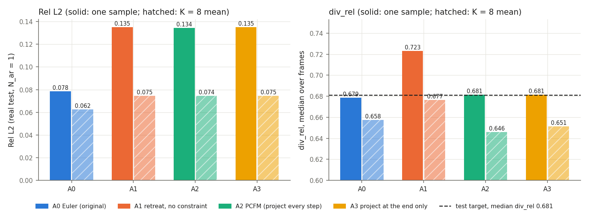
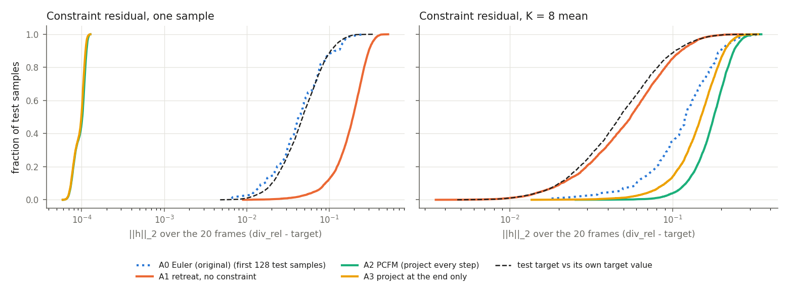
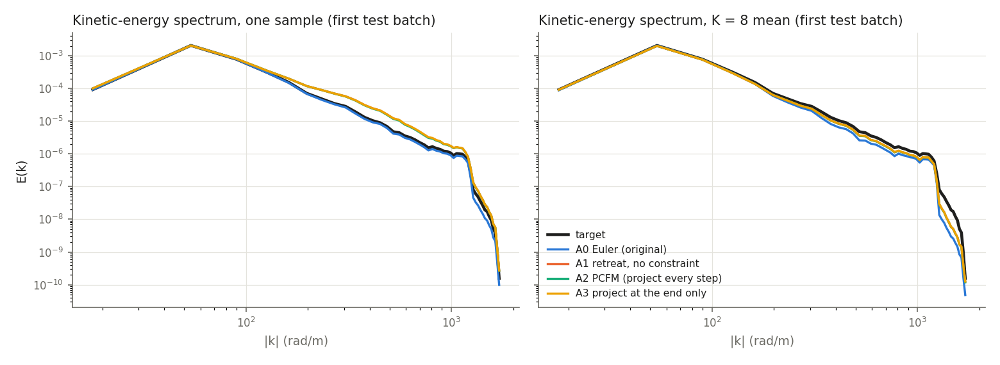
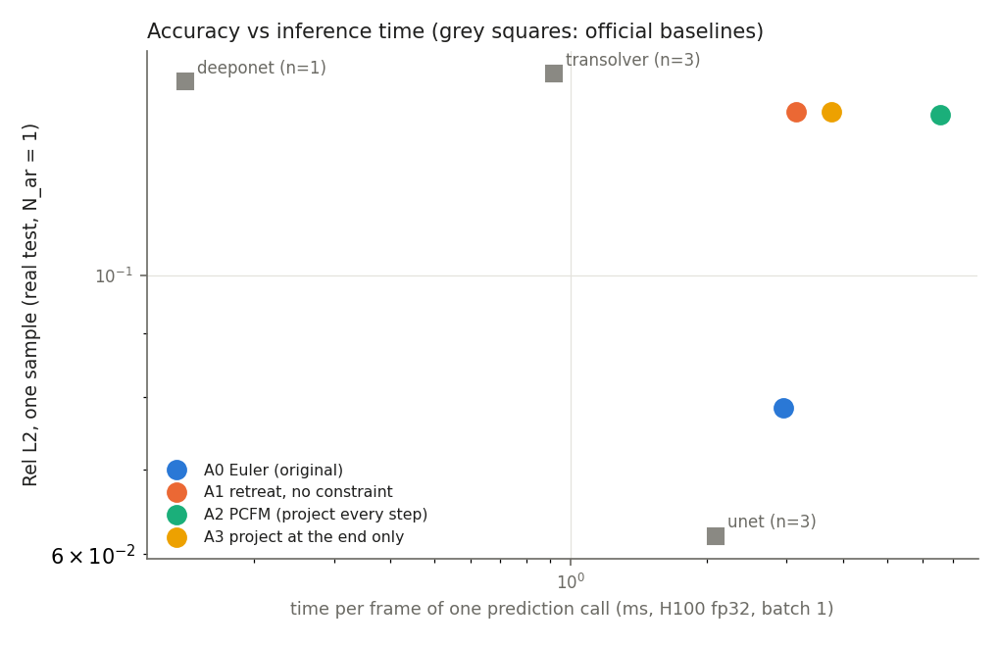
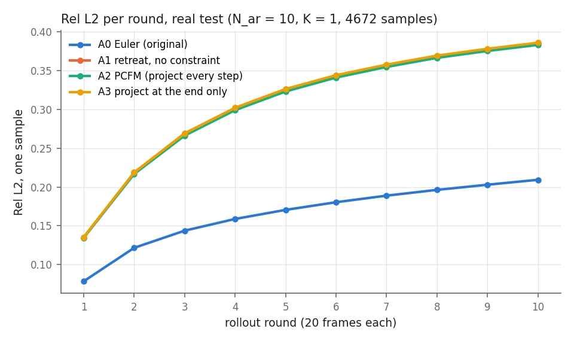
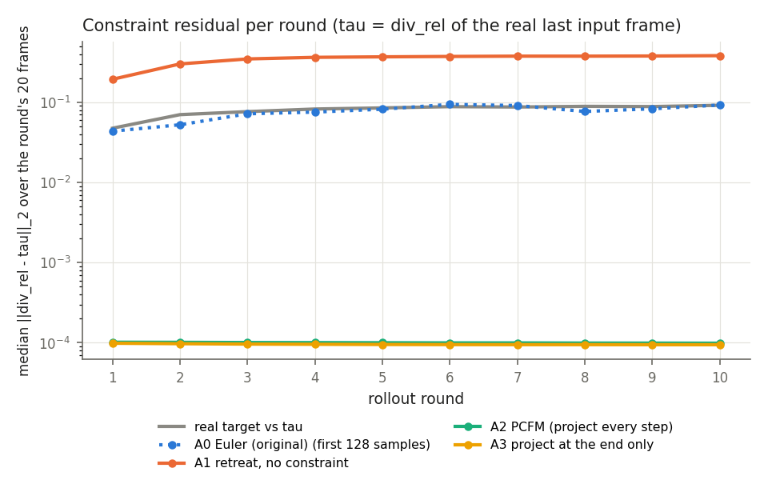
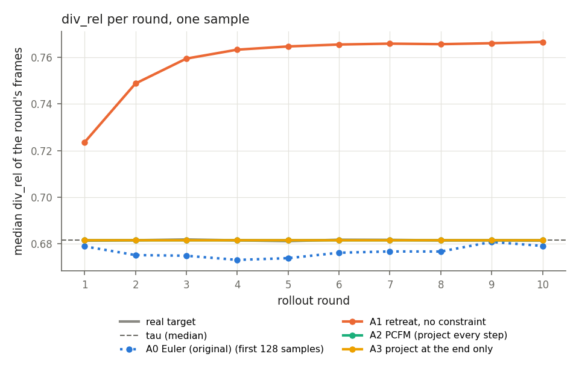

# PCFM 推論期硬約束取樣（x-pred FM）：結果總整

日期：2026-11-09。任務：[TASK_2026-11-08_pcfm-xpred.md](TASK_2026-11-08_pcfm-xpred.md)。決策紀錄：[DECISIONS.md](DECISIONS.md)（P1–P29）。

本文件只整理數字與觀察到的現象，不下研究結論。

狀態：Step 0–4 完成；Step 4 之後加做 10 輪 rollout（P24、P25）與殘差差距檢查（P26）；2026-11-16 加做只用模擬資料訓練的模型（§7，P27–P29）。

---

## 1. 設定

| 項目 | 設定 |
|---|---|
| 模型 | `dit_xpred_width` 的 R6（x-pred、width 512，`best.pt` step 50000，EMA）；只做推論（P1、P13） |
| 約束 | C2：每個輸出幀的 div_rel（D32 定義，物理單位，Ω 內）等於目標值 τ，每筆 20 個約束（P11） |
| 目標值 τ | 逐樣本：該樣本輸入最後一幀的 div_rel（P19）；10 輪 rollout 時每一輪都沿用真實輸入算出的 τ（P25） |
| 取樣方式 | A0 原本的 Euler；A1 改用「外推 → 以初始噪聲退回」但不加約束；A2 每一步把外推結果投影到約束上（一次 Gauss–Newton，ε = 1e-6），最後再做一次投影；A3 只在最後投影 |
| 最終投影 | 以最後的狀態為錨的 Newton 投影，迭代到 ‖h‖₂ < 1e-5 或 20 次（P9、P17、P22）；20 次仍未達到記為未收斂 |
| 噪聲 | 各取樣方式用同一個 generator、相同抽取順序，同一筆樣本的初始噪聲相同（P4）；test seed 1234（P12），val seed 0 |
| 評估 | real test，官方評估流程，Euler 20 步，fp32；N_ar = 1：4827 筆、每筆 K = 8；N_ar = 10：4672 筆、K = 1（P20、P24） |
| A0 數字 | 沿用 `dit_xpred_width` S6；先在前 128 筆 test 上確認新程式與原程式結果相同（§8） |

## 2. 目標值的選擇（Step 2，train / val）

真值每幀 div_rel 的中位數：train 0.6787、val 0.6816，幀間標準差 0.022。在 val 上，用一個常數當目標時與真值平均差 0.018，用樣本自己輸入最後一幀的 div_rel 時差 0.011；依此選定逐樣本目標（P19）。

## 3. 試跑（Step 3，前 128 筆 val，seed 0）

| | 相對誤差（物理單位，單一樣本） | 最終投影迭代次數 | 每批 64 筆時間 | 峰值記憶體 |
|---|---|---|---|---|
| A0 | 0.0755 | – | 1.19 s | 3.6 GiB |
| A1 | 0.1276 | – | 1.21 s | 4.8 GiB |
| A2 | 0.1270 | 0–1 | 2.20 s | 11.7 GiB |
| A3 | 0.1276 | 2–5 | 1.45 s | 12.0 GiB |

全部收斂，沒有 NaN。

## 4. 單步評估（Step 4，N_ar = 1，real test 4827 筆，K = 8）

### 4.1 準確度

| | 相對誤差 單一樣本 | 相對誤差 K=8 平均 | RMSE 單一樣本 | R² 單一樣本 | CRPS | 樣本間離散度 |
|---|---|---|---|---|---|---|
| A0 | **0.0785** | **0.0625** | 0.0153 | 0.938 | 0.00347 | 0.0050 |
| A1 | 0.1351 | 0.0746 | 0.0269 | 0.808 | 0.00397 | 0.0111 |
| A2 | 0.1344 | 0.0745 | 0.0267 | 0.810 | 0.00397 | 0.0111 |
| A3 | 0.1351 | 0.0746 | 0.0269 | 0.808 | 0.00398 | 0.0112 |

其他單一樣本指標：動能誤差 A0 1.56e-4、A1–A3 約 3.3e-4；高頻相對誤差 0.423 vs 0.746；頻率誤差 33.3 vs 52.5。完整數字在 [pcfm_xpred_nar1.csv](pcfm_xpred_nar1.csv)。

### 4.2 約束

| | div_rel 中位數 單一樣本 | div_rel 中位數 K=8 平均 | 殘差中位數 單一樣本 | 殘差中位數 K=8 平均 |
|---|---|---|---|---|
| A0 | 0.679 | 0.658 | 0.0425（前 128 筆） | 0.120（前 128 筆） |
| A1 | 0.723 | 0.677 | 0.193 | 0.055 |
| A2 | 0.681 | 0.646 | 1.0e-4 | 0.179 |
| A3 | 0.681 | 0.651 | 9.9e-5 | 0.150 |
| 真值 | 0.681 | | 0.0477 | |

殘差 = 一筆樣本 20 幀的 ‖div_rel − τ‖₂，由評估程式從被評分的物理場重新計算。取樣器內部算到的最終殘差：A2 中位數 2.5e-7、A3 中位數 3.7e-6、最大 1e-5；38,616 次取樣（4827 × 8）全部收斂，沒有 NaN。兩者的差距來源見 §5。

最終投影迭代次數（取樣次數）：A2 為 0 次 6191、1 次 32,425；A3 以 2–4 次為主（2 次 9298、3 次 21,527、4 次 7183），最多 9 次。投影前的殘差中位數：A2 1.9e-5、A3 0.193。

8 個樣本平均後散度比值下降，平均場不再滿足約束。

### 4.3 能量譜

A1–A3 三條線幾乎重疊；單一樣本在中高頻高於真值，K = 8 平均接近真值，A0 在高頻略低於真值。

### 4.4 推論時間（H100，fp32，一次 20 幀的呼叫）

| | 每幀 ms（batch 1） | 每筆 ms（batch 64） | 峰值記憶體 batch 64 |
|---|---|---|---|
| A0 | 2.95 | 18.9 | – |
| A1 | 3.15 | 18.8 | 2.6 GiB |
| A2 | 6.56 | 34.4 | 9.0 GiB |
| A3 | 3.77 | 22.2 | 8.9 GiB |

既有 baseline（Phase 4 real test）：U-Net 相對誤差 0.0620、每幀 2.09 ms（3 seeds）；DeepONet 0.143、0.14 ms（1 seed）；Transolver 0.145、0.92 ms（3 seeds）。

## 5. 評估重算殘差較大的原因（P26，前 64 筆 val）

同一份輸出依序加上各個處理步驟後的殘差中位數：

| 經過的處理 | A2 | A3 |
|---|---|---|
| 取樣器自己看到的（fp32） | 2.5e-7 | 3.4e-6 |
| 改用 fp64 計算、反正規化一次、以 fp32 存成物理場 | 1.9e-7 | 3.4e-6 |
| 再經過官方迴圈的正規化往返（= 評估實際評分的場） | 1.0e-4 | 9.8e-5 |

官方迴圈（RealPDEBench `eval.py:311–326`，`eval_xpred_width.rollout` / `evaluate` 照抄）把預測用目標統計量反正規化、再用輸入統計量正規化，評分時又用目標統計量反正規化。兩組統計量略有差異，被評分的場等於取樣器輸出的 u 乘上 0.999986、v 乘上 1.000105（另加常數偏移，不影響差分）。u、v 倍率不同使 div_rel 移動約 1e-4。這是官方行為，沒有改動；所有經過此迴圈評分的模型都一樣。

## 6. 10 輪 rollout（N_ar = 10，real test 4672 筆，K = 1）

| | 200 幀相對誤差 | RMSE | 第 1 輪 | 第 5 輪 | 第 10 輪 | 各輪 div_rel 中位數 | 各輪殘差中位數 |
|---|---|---|---|---|---|---|---|
| A0 | **0.170** | 0.0313 | 0.078 | 0.170 | 0.209 | 0.673–0.681（前 128 筆） | 0.044–0.094（前 128 筆） |
| A1 | 0.318 | 0.0588 | 0.135 | 0.326 | 0.385 | 0.724 → 0.767 | 0.19 → 0.38 |
| A2 | 0.316 | 0.0582 | 0.134 | 0.323 | 0.383 | 0.6815 | 約 1.0e-4 |
| A3 | 0.319 | 0.0587 | 0.135 | 0.326 | 0.386 | 0.6815 | 約 9.6e-5 |
| 真值 | | | | | | 0.681–0.682 | 0.048 → 0.092 |

- 三種新取樣方式之間的相對誤差差距每一輪都小於 0.003；與 A0 的差距從第 1 輪 0.057 增加到第 10 輪約 0.18。
- A2、A3 每一輪的殘差都約 1e-4（§5 的量級）；A1 的 div_rel 逐輪上升；真值本身離 τ 的距離也逐輪增加。
- A2：46,720 次取樣全部在 0–1 次迭代內收斂。A3：189 次（0.4%）達到 20 次上限，最終殘差最大 1.43e-5（門檻 1e-5），沒有 NaN；其評估重算殘差最大 1.31e-4，與其他樣本相同量級。A3 投影前的殘差中位數 0.27（N_ar = 1 時 0.19）。
- 整份 test 評估時間：A0 1490 s、A1 1389 s、A2 2145 s、A3 1704 s。

完整數字在 [pcfm_xpred_nar10.csv](pcfm_xpred_nar10.csv)。

## 7. 只用模擬資料訓練的模型（P27–P29，N_ar = 1，real test 4827 筆，K = 8）

R6 只用 real 資料訓練，測不到 sim-to-real。這一節另外訓練 R6num：config 和 R6 相同，只把訓練資料改成 numerical（官方流程：輸入和目標都加 10% 乘性噪聲、壓力通道以 0.5 的機率遮蔽），seed 0，50k 步。checkpoint 和 R6 一樣，用 536 筆 real val 子集選點（P28）。評估設定與 §4 完全相同（seed 1234、同一組噪聲），A0 也重新跑。

**選出的 checkpoint 只訓練了 4000 步。** real val 的相對誤差在第 4000 步最低（0.199），之後一路上升，第 50k 步是 0.242；模擬資料上的訓練 loss 則持續下降。這與 Phase 6 的 numerical 模型相同（模擬訓練越久，在 real 上越差）。用 real val 選點用到了 real 資料，所以下面的數字是「只用模擬訓練」的上限。

| | 相對誤差 單一樣本 | 相對誤差 K=8 平均 | RMSE 單一樣本 | R² 單一樣本 | CRPS | 樣本間離散度 |
|---|---|---|---|---|---|---|
| A0 | **0.203** | **0.194** | 0.0358 | 0.660 | 0.0154 | 0.0082 |
| A1 | 0.214 | 0.202 | 0.0377 | 0.622 | 0.0157 | 0.0099 |
| A2 | 0.214 | 0.201 | 0.0376 | 0.624 | 0.0157 | 0.0100 |
| A3 | 0.214 | 0.201 | 0.0377 | 0.623 | 0.0157 | 0.0100 |
| 參考：R6 A0 | 0.0785 | 0.0625 | 0.0153 | 0.938 | 0.00347 | 0.0050 |
| 參考：直接複製最後一幀 | 0.181 | | 0.0364 | 0.648 | | |

| | div_rel 中位數 單一樣本 | div_rel 中位數 K=8 平均 | 殘差中位數 單一樣本 | 殘差中位數 K=8 平均 |
|---|---|---|---|---|
| A0 | 0.702 | 0.703 | 0.118 | 0.125 |
| A1 | 0.704 | 0.703 | 0.119 | 0.123 |
| A2 | 0.681 | 0.683 | 1.0e-5 | 0.024 |
| A3 | 0.681 | 0.685 | 1.4e-5 | 0.029 |
| 真值 | 0.681 | | 0.0477 | |

- 不加約束時，R6num 的相對誤差 0.203，比直接複製最後一幀（0.181）差，與 Phase 6 的 numerical FM（0.195–0.217）一致。
- R6num 輸出的 div_rel 並不低：中位數 0.702，比目標值 0.681 略高，與模擬資料本身的 0.12 差很遠。可能的原因（未驗證）是訓練目標帶有 10% 乘性噪聲。因此約束只需要做小幅修正。
- 三種新取樣方式彼此幾乎相同，都比 A0 差約 0.011（R6 上差約 0.057）。
- 和 R6 不同的是，8 個樣本平均後 A2、A3 仍接近約束（殘差 0.024–0.029，R6 是 0.15–0.18），因為 R6num 的樣本間差異較小。
- 這裡的殘差（約 1e-5）比 §4.2 的約 1e-4 小。評估迴圈的正規化往返仍然存在（§5），但沒有再查證殘差變小的原因。
- 最終投影：A2 的 38,616 次取樣全部 1 次迭代收斂；A3 以 2–4 次為主，有 17 次（0.04%）達到 20 次上限，最終殘差最大 8.8e-4，依 P18 照實記錄，沒有 NaN。
- 其他單一樣本指標：高頻相對誤差 A0 0.912、A1–A3 約 0.963；頻率誤差 151 vs 約 160。
- 整份 test 評估時間：A0 835 s、A1 807 s、A2 1396 s、A3 1099 s。

完整數字在 [pcfm_xpred_sim-trained.csv](pcfm_xpred_sim-trained.csv)（含 R6 的對照列），val 曲線在 [pcfm_xpred_sim-trained_val-curve.csv](pcfm_xpred_sim-trained_val-curve.csv)。

## 8. 驗證

- 單元測試 `fm/tests/test_constrained.py`：投影、vmap、逐樣本目標（Step 1、Step 2）全部通過。
- A0 重現（N_ar = 1，前 128 筆 test）：原程式、新程式預設、新程式加殘差計算三者所有欄位逐位元相同，只有能量譜最後一兩位數不同（最大相對差 3.8e-16，真值頻譜也一樣，來源是 GPU 累加順序）。
- A0 重現（N_ar = 10，前 128 筆 test）：三者所有欄位完全相同（最大相對差 0）。
- A2 的 10 輪路徑先在 64 筆 test 上試跑，每輪殘差正常、全部收斂。
- numerical cache（§7）：單元測試 (f) 確認 cache 讀出的 numerical train 樣本（含遮蔽與加噪的亂數）和官方 loader 逐位元相同。

## 9. 限制與注意事項

- 主要結果只用一個模型（R6）、一個噪聲種子（1234），只做 C2 一種約束；模擬訓練的 R6num 只有 1 個訓練 seed，只做 N_ar = 1，沒有做 sim 預訓練 + real 微調。
- R6num 的 checkpoint 用 real val 選出（P28），代表上限；只訓練 4000 步的點被選中。
- A0 的約束殘差與 10 輪的 div_rel 只在前 128 筆 test 上計算。
- 新取樣方式的誤差增加幾乎都來自「以初始噪聲退回」本身（A1 與 A2、A3 幾乎相同）；Euler 等價於以當前狀態反推的噪聲退回。未測試反推噪聲的變體（P23）。
- 評估重算的殘差約 1e-4 由官方評估迴圈造成（§5），不是取樣器的精度。

## 10. 算力

| 項目 | GPU-h（H100） |
|---|---|
| Step 0–3（探查、單元測試、目標值統計、試跑） | 約 0.08 |
| Step 4（重現檢查 + A1–A3 評估） | 約 0.96 |
| 10 輪 rollout 與殘差差距檢查 | 約 1.54 |
| 模擬訓練的模型（cache + 單元測試 0.05、訓練 1.63、A0–A3 評估 1.15） | 約 2.83 |
| 反推噪聲的退回（§12：檢查 0.04、兩種評估 0.69） | 約 0.73 |
| 反推噪聲的 10 輪 rollout（§12.2：檢查 0.04、兩種評估 1.27） | 約 1.31 |

## 11. 檔案位置

結果根目錄：`/work/b314513067/pi-lfm/results/fm/2026-11-08_pcfm-xpred/`

| 子目錄 | 內容 |
|---|---|
| `S0_inventory/` | 模型、正規化、Ω 的探查 |
| `S1_sampler-impl/` | 取樣器實作的驗證 |
| `S2_div-target-stats/` | 目標值統計、逐樣本目標的單元測試 |
| `S3_smoke-val/` | val 試跑 |
| `S4_eval-test/` | `eval/`、`bench/`、`repro/`（A0 重現）、`summary/`（CSV、圖）、送出時的程式碼狀態 |
| `S5_residual-gap-val/` | 殘差差距檢查（`residual_gap.json`、`residual_gap_verdict.md`） |
| `S5_rollout10-test/` | 10 輪 rollout 的 `eval/`、`repro/`、`smoke/`、`summary/` |
| `S6_sim-trained-model/` | 模擬訓練的模型：`cache-build/`（numerical cache 與單元測試）、`train-50k/R6num_xpred_w512/`（checkpoint、log）、`eval/`、`summary/`（`summarize_s6.py`、CSV）、送出時的程式碼狀態 |
| `S7_implied-noise-retreat/` | 反推噪聲的退回：`check/`（單元測試 v9、前 128 筆 test 與 Euler 的比對）、`bench/`、`eval/`、`summary/`（`summarize_s7.py`、CSV）、送出時的程式碼狀態 |
| `S8_implied-noise-rollout10-test/` | 反推噪聲的 10 輪 rollout：`check/`（前 128 筆 test 與 Euler 10 輪結果的比對）、`eval/`、`summary/`（CSV、圖 1–3，含 S5 的 A0–A3） |

程式：`fm/constrained.py`（約束與取樣器）、`fm/wrapper.py`（`FMPredictor` 的取樣器開關）、`fm/tests/test_constrained.py`；`scripts/pcfm_xpred_div_stats.py`（Step 2）、`scripts/pcfm_xpred_smoke.py`（Step 3）、`scripts/eval_xpred_width.py --sampler`（Step 4、10 輪）、`scripts/pcfm_xpred_residual_gap.py`（§5）、`scripts/summarize_pcfm_xpred.py`、`scripts/summarize_pcfm_xpred_nar10.py`（CSV、圖）。

## 12. 退回時改用反推的噪聲（P30–P31）

### 12.1 單步評估（P30，N_ar = 1，real test 4827 筆，K = 8）

**做法。** 原本的 A1–A3 每一步都用初始噪聲把預測的 x 退回到下一個時間點（P4）。這個變體改成：每一步先用當前狀態和網路的原始輸出反推出「這個狀態對應的噪聲」(y_t − t·x)/(1 − t)，再用它和（投影後的）x 內插到下一個時間點（`--retreat implied`）。不加約束時，這和原本的 Euler 取樣代數上完全相同；所以「只在最後投影」的版本就是原本的 Euler 樣本再做一次最終投影，「每步投影」的版本則是每一步朝投影後的 x 走一步 Euler。模型 R6，noise seed 1234，其餘同 §4。

**驗證。** 單元測試 v9 通過：不加約束時和 Euler 的最大差 2.3e-5（用初始噪聲時是 0.046），「只在最後投影」和「Euler 樣本 + 投影」完全相同。前 128 筆 test 上，不加約束的反推版本和原本的 Euler 結果在所有官方指標上的相對差都 ≤ 1e-6（`check/interp-implied_vs_euler_128.json`）。

**結果。**

| 取樣方式 | 單一樣本 Rel L2 | K = 8 平均 Rel L2 | 單一樣本 div_rel 中位數 | K = 8 平均 div_rel 中位數 | 評估重算殘差中位數 |
|---|---|---|---|---|---|
| A0 Euler（原本） | 0.0785 | 0.0625 | 0.679 | 0.658 | — |
| A1 不加約束，初始噪聲 | 0.1351 | 0.0746 | 0.723 | 0.677 | 0.193 |
| A2 每步投影，初始噪聲 | 0.1344 | 0.0745 | 0.681 | 0.646 | 1.0e-4 |
| A3 只在最後投影，初始噪聲 | 0.1351 | 0.0746 | 0.681 | 0.651 | 9.9e-5 |
| A2' 每步投影，反推噪聲 | 0.0787 | 0.0625 | 0.681 | 0.664 | 1.0e-4 |
| A3' 只在最後投影，反推噪聲（= A0 + 投影） | 0.0785 | 0.0625 | 0.681 | 0.660 | 1.0e-4 |

測試集真值的 div_rel 中位數 0.681。

- 改用反推噪聲後，誤差回到 A0 的水準（單一樣本 0.0787 / 0.0785，A0 0.0785），同時約束成立。§4 中 A1–A3 誤差變大，原因是「用初始噪聲退回」本身，不是約束。
- 約束本身沒有改善準確度：A3' 和 A0 的差在第四位小數（K = 8 平均 0.06246 vs 0.06246），A2' 稍差（0.0787 vs 0.0785）。高頻誤差、CRPS、spread 也與 A0 相同（CSV）。
- K = 8 平均的 div_rel 仍低於目標（0.660–0.664），因為平均多個樣本會把流場抹平；約束只對單一樣本成立。
- 收斂：A2' 的最終投影 0–1 次即達到 1e-5（38,616 次取樣全部收斂）；A3' 中位數 2 次，13 次取樣（0.03%）到 20 次仍未收斂，最大殘差 0.017（A3 用初始噪聲時全部收斂）。投影前的殘差：A2' 中位數 4e-6，A3' 0.047。
- 時間（H100 fp32，batch 1，一次 20 幀）：A2' 130 ms、A3' 72 ms，A0 59 ms（§4.4）。全量評估：A2' 1454 s、A3' 1024 s。

**結論。** 在 R6 上，用反推噪聲可以在不損失準確度的情況下讓每個樣本的 div_rel 精確等於目標，但不會讓預測更準；先前 PCFM 變差是退回方式造成的。

檔案：`S7_implied-noise-retreat/`；CSV 副本 `docs/pcfm_xpred/pcfm_xpred_implied-noise.csv`。

### 12.2 10 輪 rollout（P31，N_ar = 10，real test 4672 筆，K = 1）

設定同 §6（noise seed 1234，每一輪的目標值都是真實輸入最後一幀的 div_rel）。先在前 128 筆 test 上確認不加約束的反推版本重現 A0 的 10 輪結果：所有官方指標與每一輪 Rel L2 的相對差最大 3.2e-5（容許 1e-3，`check/interp-implied_vs_euler_nar10_128.json`）。

| 取樣方式 | 10 輪整體 Rel L2 | 第 1 輪 | 第 5 輪 | 第 10 輪 | div_rel 中位數（第 1 / 第 10 輪） |
|---|---|---|---|---|---|
| A0 Euler（原本） | 0.170 | 0.078 | 0.170 | 0.209 | 0.679 / 0.679（前 128 筆） |
| A1 不加約束，初始噪聲 | 0.318 | 0.135 | 0.326 | 0.385 | 0.724 / 0.767 |
| A2 每步投影，初始噪聲 | 0.316 | 0.134 | 0.323 | 0.383 | 0.682 / 0.682 |
| A3 只在最後投影，初始噪聲 | 0.319 | 0.135 | 0.326 | 0.386 | 0.682 / 0.682 |
| A2' 每步投影，反推噪聲 | 0.172 | 0.079 | 0.172 | 0.212 | 0.682 / 0.682 |
| A3' 只在最後投影，反推噪聲 | 0.171 | 0.079 | 0.171 | 0.210 | 0.682 / 0.682 |

真值的 div_rel 中位數每輪約 0.681–0.682。

- 反推噪聲的兩種方式在 10 輪中都貼著 A0：整體 0.172 / 0.171 vs 0.170，第 10 輪 0.212 / 0.210 vs 0.209。用初始噪聲的 A1–A3 從第 1 輪起就差很多，第 10 輪約 0.385。
- 約束在 rollout 中也沒有改善準確度。原本的 Euler 不加約束時，div_rel 每輪都維持在 0.675–0.681，沒有漂移（漂移到 0.77 的是用初始噪聲退回的 A1），所以約束沒有東西可修；A2' 稍差（第 10 輪多 0.003）。
- 收斂：A2' 全部收斂（最終投影 0–1 次）；A3' 有 63 / 46,720 次取樣（0.13%）到 20 次仍未收斂，最大殘差 0.116（用初始噪聲的 A3 是 189 次，最大 1.4e-5）。
- 全量評估時間：A2' 2500 s、A3' 2045 s（A0 1490 s）。

**結論。** 在 10 輪 rollout 中，反推噪聲同樣讓 PCFM 回到原本 Euler 的準確度、同時讓每一輪的 div_rel 精確等於目標，但不會比不加約束更準。

檔案：`S8_implied-noise-rollout10-test/`；CSV 副本 `docs/pcfm_xpred/pcfm_xpred_nar10_implied-noise.csv`。
