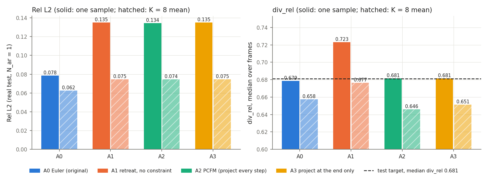
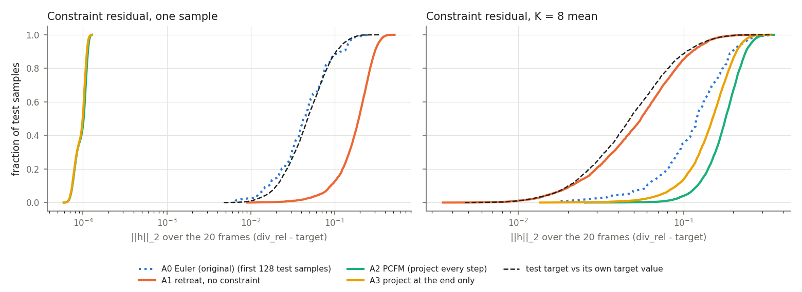
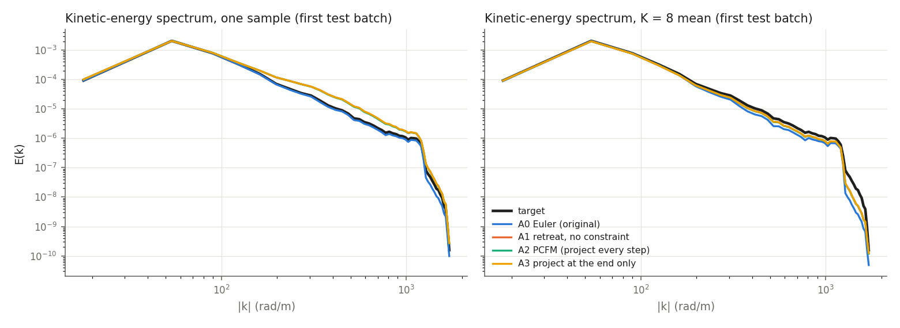
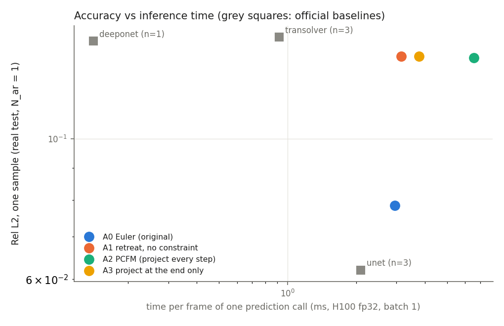
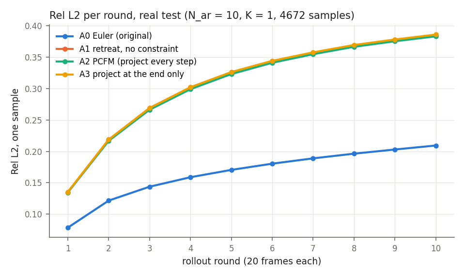
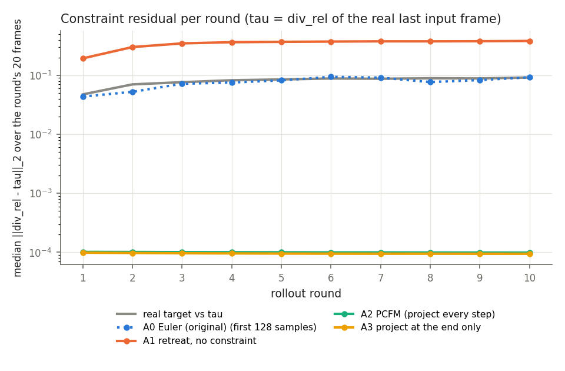
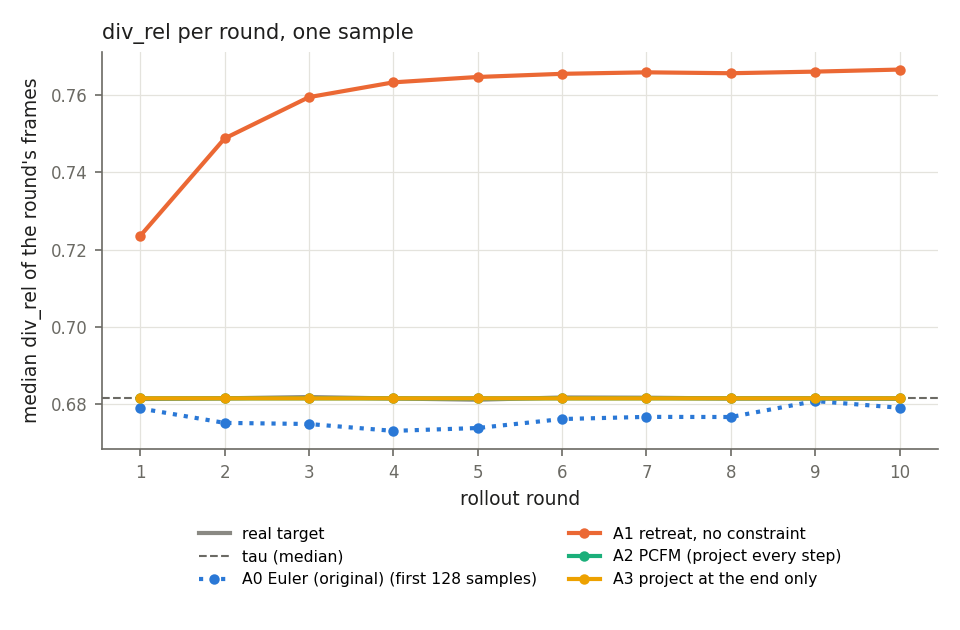

# PCFM 推論期硬約束取樣（x-pred FM）：結果總整

日期：2026-11-09。任務：[TASK_2026-11-08_pcfm-xpred.md](TASK_2026-11-08_pcfm-xpred.md)。決策紀錄：[DECISIONS.md](DECISIONS.md)（P1–P26）。

本文件只整理數字與觀察到的現象，不下研究結論。

狀態：Step 0–4 完成；Step 4 之後加做 10 輪 rollout（P24、P25）與殘差差距檢查（P26）。

---

## 1. 設定

| 項目 | 設定 |
|---|---|
| 模型 | `dit_xpred_width` 的 R6（x-pred、width 512，`best.pt` step 50000，EMA）；只做推論（P1、P13） |
| 約束 | C2：每個輸出幀的 div_rel（D32 定義，物理單位，Ω 內）等於目標值 τ，每筆 20 個約束（P11） |
| 目標值 τ | 逐樣本：該樣本輸入最後一幀的 div_rel（P19）；10 輪 rollout 時每一輪都沿用真實輸入算出的 τ（P25） |
| 取樣方式 | A0 原本的 Euler；A1 改用「外推 → 以初始噪聲退回」但不加約束；A2 每一步把外推結果投影到約束上（一次 Gauss–Newton，ε = 1e-6），最後再做一次投影；A3 只在最後投影 |
| 最終投影 | 以最後的狀態為錨的 Newton 投影，迭代到 ‖h‖₂ < 1e-5 或 20 次（P9、P17、P22）；20 次仍未達到記為未收斂 |
| 噪聲 | 各取樣方式用同一個 generator、相同抽取順序，同一筆樣本的初始噪聲相同（P4）；test seed 1234（P12），val seed 0 |
| 評估 | real test，官方評估流程，Euler 20 步，fp32；N_ar = 1：4827 筆、每筆 K = 8；N_ar = 10：4672 筆、K = 1（P20、P24） |
| A0 數字 | 沿用 `dit_xpred_width` S6；先在前 128 筆 test 上確認新程式與原程式結果相同（§6） |

## 2. 目標值的選擇（Step 2，train / val）

真值每幀 div_rel 的中位數：train 0.6787、val 0.6816，幀間標準差 0.022。在 val 上，用一個常數當目標時與真值平均差 0.018，用樣本自己輸入最後一幀的 div_rel 時差 0.011；依此選定逐樣本目標（P19）。

## 3. 試跑（Step 3，前 128 筆 val，seed 0）

| | 相對誤差（物理單位，單一樣本） | 最終投影迭代次數 | 每批 64 筆時間 | 峰值記憶體 |
|---|---|---|---|---|
| A0 | 0.0755 | – | 1.19 s | 3.6 GiB |
| A1 | 0.1276 | – | 1.21 s | 4.8 GiB |
| A2 | 0.1270 | 0–1 | 2.20 s | 11.7 GiB |
| A3 | 0.1276 | 2–5 | 1.45 s | 12.0 GiB |

全部收斂，沒有 NaN。

## 4. 單步評估（Step 4，N_ar = 1，real test 4827 筆，K = 8）

### 4.1 準確度

| | 相對誤差 單一樣本 | 相對誤差 K=8 平均 | RMSE 單一樣本 | R² 單一樣本 | CRPS | 樣本間離散度 |
|---|---|---|---|---|---|---|
| A0 | **0.0785** | **0.0625** | 0.0153 | 0.938 | 0.00347 | 0.0050 |
| A1 | 0.1351 | 0.0746 | 0.0269 | 0.808 | 0.00397 | 0.0111 |
| A2 | 0.1344 | 0.0745 | 0.0267 | 0.810 | 0.00397 | 0.0111 |
| A3 | 0.1351 | 0.0746 | 0.0269 | 0.808 | 0.00398 | 0.0112 |

其他單一樣本指標：動能誤差 A0 1.56e-4、A1–A3 約 3.3e-4；高頻相對誤差 0.423 vs 0.746；頻率誤差 33.3 vs 52.5。完整數字在 [pcfm_xpred_nar1.csv](pcfm_xpred_nar1.csv)。

### 4.2 約束

| | div_rel 中位數 單一樣本 | div_rel 中位數 K=8 平均 | 殘差中位數 單一樣本 | 殘差中位數 K=8 平均 |
|---|---|---|---|---|
| A0 | 0.679 | 0.658 | 0.0425（前 128 筆） | 0.120（前 128 筆） |
| A1 | 0.723 | 0.677 | 0.193 | 0.055 |
| A2 | 0.681 | 0.646 | 1.0e-4 | 0.179 |
| A3 | 0.681 | 0.651 | 9.9e-5 | 0.150 |
| 真值 | 0.681 | | 0.0477 | |

殘差 = 一筆樣本 20 幀的 ‖div_rel − τ‖₂，由評估程式從被評分的物理場重新計算。取樣器內部算到的最終殘差：A2 中位數 2.5e-7、A3 中位數 3.7e-6、最大 1e-5；38,616 次取樣（4827 × 8）全部收斂，沒有 NaN。兩者的差距來源見 §5。

最終投影迭代次數（取樣次數）：A2 為 0 次 6191、1 次 32,425；A3 以 2–4 次為主（2 次 9298、3 次 21,527、4 次 7183），最多 9 次。投影前的殘差中位數：A2 1.9e-5、A3 0.193。

8 個樣本平均後散度比值下降，平均場不再滿足約束。

### 4.3 能量譜

A1–A3 三條線幾乎重疊；單一樣本在中高頻高於真值，K = 8 平均接近真值，A0 在高頻略低於真值。

### 4.4 推論時間（H100，fp32，一次 20 幀的呼叫）

| | 每幀 ms（batch 1） | 每筆 ms（batch 64） | 峰值記憶體 batch 64 |
|---|---|---|---|
| A0 | 2.95 | 18.9 | – |
| A1 | 3.15 | 18.8 | 2.6 GiB |
| A2 | 6.56 | 34.4 | 9.0 GiB |
| A3 | 3.77 | 22.2 | 8.9 GiB |

既有 baseline（Phase 4 real test）：U-Net 相對誤差 0.0620、每幀 2.09 ms（3 seeds）；DeepONet 0.143、0.14 ms（1 seed）；Transolver 0.145、0.92 ms（3 seeds）。

## 5. 評估重算殘差較大的原因（P26，前 64 筆 val）

同一份輸出依序加上各個處理步驟後的殘差中位數：

| 經過的處理 | A2 | A3 |
|---|---|---|
| 取樣器自己看到的（fp32） | 2.5e-7 | 3.4e-6 |
| 改用 fp64 計算、反正規化一次、以 fp32 存成物理場 | 1.9e-7 | 3.4e-6 |
| 再經過官方迴圈的正規化往返（= 評估實際評分的場） | 1.0e-4 | 9.8e-5 |

官方迴圈（RealPDEBench `eval.py:311–326`，`eval_xpred_width.rollout` / `evaluate` 照抄）把預測用目標統計量反正規化、再用輸入統計量正規化，評分時又用目標統計量反正規化。兩組統計量略有差異，被評分的場等於取樣器輸出的 u 乘上 0.999986、v 乘上 1.000105（另加常數偏移，不影響差分）。u、v 倍率不同使 div_rel 移動約 1e-4。這是官方行為，沒有改動；所有經過此迴圈評分的模型都一樣。

## 6. 10 輪 rollout（N_ar = 10，real test 4672 筆，K = 1）

| | 200 幀相對誤差 | RMSE | 第 1 輪 | 第 5 輪 | 第 10 輪 | 各輪 div_rel 中位數 | 各輪殘差中位數 |
|---|---|---|---|---|---|---|---|
| A0 | **0.170** | 0.0313 | 0.078 | 0.170 | 0.209 | 0.673–0.681（前 128 筆） | 0.044–0.094（前 128 筆） |
| A1 | 0.318 | 0.0588 | 0.135 | 0.326 | 0.385 | 0.724 → 0.767 | 0.19 → 0.38 |
| A2 | 0.316 | 0.0582 | 0.134 | 0.323 | 0.383 | 0.6815 | 約 1.0e-4 |
| A3 | 0.319 | 0.0587 | 0.135 | 0.326 | 0.386 | 0.6815 | 約 9.6e-5 |
| 真值 | | | | | | 0.681–0.682 | 0.048 → 0.092 |

- 三種新取樣方式之間的相對誤差差距每一輪都小於 0.003；與 A0 的差距從第 1 輪 0.057 增加到第 10 輪約 0.18。
- A2、A3 每一輪的殘差都約 1e-4（§5 的量級）；A1 的 div_rel 逐輪上升；真值本身離 τ 的距離也逐輪增加。
- A2：46,720 次取樣全部在 0–1 次迭代內收斂。A3：189 次（0.4%）達到 20 次上限，最終殘差最大 1.43e-5（門檻 1e-5），沒有 NaN；其評估重算殘差最大 1.31e-4，與其他樣本相同量級。A3 投影前的殘差中位數 0.27（N_ar = 1 時 0.19）。
- 整份 test 評估時間：A0 1490 s、A1 1389 s、A2 2145 s、A3 1704 s。

完整數字在 [pcfm_xpred_nar10.csv](pcfm_xpred_nar10.csv)。

## 7. 驗證

- 單元測試 `fm/tests/test_constrained.py`：投影、vmap、逐樣本目標（Step 1、Step 2）全部通過。
- A0 重現（N_ar = 1，前 128 筆 test）：原程式、新程式預設、新程式加殘差計算三者所有欄位逐位元相同，只有能量譜最後一兩位數不同（最大相對差 3.8e-16，真值頻譜也一樣，來源是 GPU 累加順序）。
- A0 重現（N_ar = 10，前 128 筆 test）：三者所有欄位完全相同（最大相對差 0）。
- A2 的 10 輪路徑先在 64 筆 test 上試跑，每輪殘差正常、全部收斂。

## 8. 限制與注意事項

- 只用一個模型（R6）、一個噪聲種子（1234），只做 C2 一種約束。
- A0 的約束殘差與 10 輪的 div_rel 只在前 128 筆 test 上計算。
- 新取樣方式的誤差增加幾乎都來自「以初始噪聲退回」本身（A1 與 A2、A3 幾乎相同）；Euler 等價於以當前狀態反推的噪聲退回。未測試反推噪聲的變體（P23）。
- 評估重算的殘差約 1e-4 由官方評估迴圈造成（§5），不是取樣器的精度。

## 9. 算力

| 項目 | GPU-h（H100） |
|---|---|
| Step 0–3（探查、單元測試、目標值統計、試跑） | 約 0.08 |
| Step 4（重現檢查 + A1–A3 評估） | 約 0.96 |
| 10 輪 rollout 與殘差差距檢查 | 約 1.54 |

## 10. 檔案位置

結果根目錄：`/work/b314513067/pi-lfm/results/fm/2026-11-08_pcfm-xpred/`

| 子目錄 | 內容 |
|---|---|
| `S0_inventory/` | 模型、正規化、Ω 的探查 |
| `S1_sampler-impl/` | 取樣器實作的驗證 |
| `S2_div-target-stats/` | 目標值統計、逐樣本目標的單元測試 |
| `S3_smoke-val/` | val 試跑 |
| `S4_eval-test/` | `eval/`、`bench/`、`repro/`（A0 重現）、`summary/`（CSV、圖）、送出時的程式碼狀態 |
| `S5_residual-gap-val/` | 殘差差距檢查（`residual_gap.json`、`residual_gap_verdict.md`） |
| `S5_rollout10-test/` | 10 輪 rollout 的 `eval/`、`repro/`、`smoke/`、`summary/` |

程式：`fm/constrained.py`（約束與取樣器）、`fm/wrapper.py`（`FMPredictor` 的取樣器開關）、`fm/tests/test_constrained.py`；`scripts/pcfm_xpred_div_stats.py`（Step 2）、`scripts/pcfm_xpred_smoke.py`（Step 3）、`scripts/eval_xpred_width.py --sampler`（Step 4、10 輪）、`scripts/pcfm_xpred_residual_gap.py`（§5）、`scripts/summarize_pcfm_xpred.py`、`scripts/summarize_pcfm_xpred_nar10.py`（CSV、圖）。
