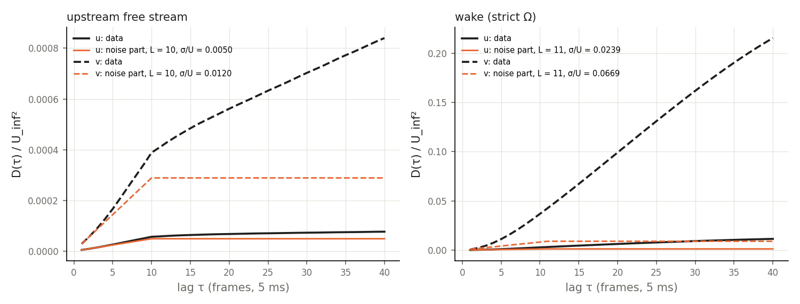
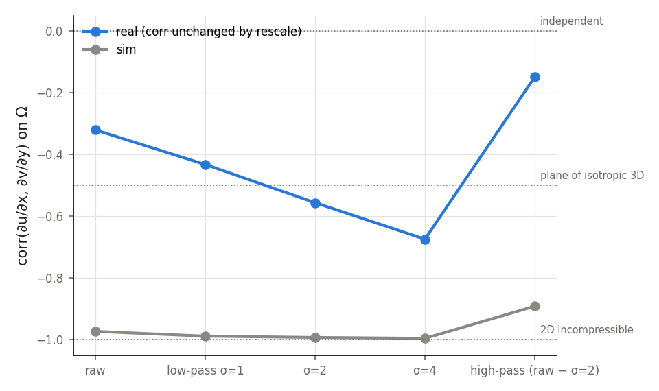
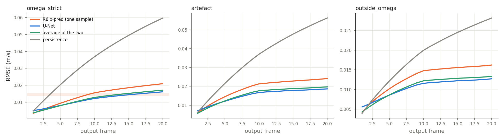

# real 資料能不能當參考答案：三項檢查（2026-10-29）

資料：RealPDEBench cylinder v2.0.1，real（PIV）92 條 trajectory 的全部幀；sim 取 16 條作對照。
程式：`pi-lfm-code/scripts/realdata_checks.py`，job 418243（dev，1 張 H100，4.5 分鐘）。
Ω、假影區、障礙物遮罩沿用 CLFT Phase 1（`run_E.geometry`，唯讀）。

自我檢查：U-Net（Phase 4 real seed 0）的 test RMSE 0.0121114，與 Phase 4 官方值相同；R6 單一樣本 0.01528，與 Step 6 相同。

## 1. 量測誤差的大小

方法：時間結構函數 D(τ) = ⟨(f(t+τ) − f(t))²⟩（f 為扣掉時間平均的 u 或 v）。「白雜訊經過 L 幀滑動平均」的貢獻是 2σ²·min(τ/L, 1)，平滑流場的貢獻是 τ²、τ⁴、τ⁶；在 τ = 1–30 上擬合，掃 L = 1–20。

| 區域 | L（最佳） | σ_u / U_inf | σ_v / U_inf | σ_v / σ_u |
|---|---|---|---|---|
| 上游自由流 | 10 | 0.0050 | 0.0120 | 2.4 |
| 尾流（strict Ω） | 11 | 0.0239 | 0.0669 | 2.8 |

- 92 條各自擬合的 L 都是 10–12。論文寫的「10 步滑動平均」是套用在降採樣後的 5 ms 幀上，窗口 50 ms。
- 上游 σ_u / U = 0.5%，和論文寫的水槽紊流強度 < 1% 一致。
- 換算成官方指標的下限（尾流 σ² 只算 Ω 內格點，或套到全部格點）：RMSE 0.0136–0.0153 m/s，Rel L2 0.067–0.076。
- 對照：U-Net 0.0121、R6 單一樣本 0.0153、x-pred K = 8 平均 0.0120–0.0125。

## 2. 誤差能不能學

### 2a. 模型逐幀誤差（strict Ω，RMSE m/s）

| 輸出幀 | 1 | 5 | 9 | 10 | 11 | 15 | 20 |
|---|---|---|---|---|---|---|---|
| R6 單一樣本 | 0.0035 | 0.0094 | 0.0145 | 0.0156 | 0.0163 | 0.0186 | 0.0209 |
| U-Net | 0.0050 | 0.0081 | 0.0115 | 0.0122 | 0.0127 | 0.0144 | 0.0161 |
| 兩者平均 | 0.0037 | 0.0080 | 0.0120 | 0.0128 | 0.0134 | 0.0152 | 0.0171 |
| persistence | 0.0048 | 0.0204 | 0.0339 | 0.0369 | 0.0397 | 0.0495 | 0.0597 |

- 三種預測在三個區域都在第 10 幀出現轉折：第 1–10 幀上升快，之後變慢。轉折位置和滑動平均的窗口相同。
- U-Net 在第 10 幀以後落在第 1 節估計的下限範圍（0.0136–0.0153）附近。
- R6 和 U-Net 的誤差相關係數 0.69（第 1 幀 0.48，第 10 幀以後約 0.70）。

### 2b. 非物理格點

| 項目 | 格點占比 | 能量占比 | 模型平方誤差占比（R6 / U-Net） |
|---|---|---|---|
| Ω 外（邊界 4 格、圓柱、PIV 失效） | 20.4% | 18.7% | 15.8% / 16.1% |
| Ω 內的假影區 | 7.7% | 7.6% | 12.6% / 12.7% |

- 圓柱內部（2.4% 的格點）的 u 平均為 0.48 U_inf，物理上應為 0。
- 沒有凍結不動的格點。

## 3. 物理設定與梯度統計

設定（論文附錄 B.2、B.3，CLFT S0）：sim 是 Lilypad 2D；real 是水槽 PIV，中跨面 z = 150 mm、光頁約 2 mm 厚，PIVLab 最終窗口 24×24 px（50% 重疊），去除壞向量後以線性內插補洞，再做 10 幀滑動平均；Re 1800–12000。

corr(∂u/∂x, ∂v/∂y) 在 Ω 上（參考值：2D 不可壓 −1；穿過 3D 等向性亂流的平面 −0.5；互相獨立 0）：

| 尺度 | 原始 | 低通 σ = 1 格 | σ = 2 | σ = 4 | 高通（原始 − σ=2） |
|---|---|---|---|---|---|
| real | −0.32 | −0.43 | −0.56 | −0.67 | −0.15 |
| sim | −0.97 | −0.99 | −0.99 | −1.00 | −0.89 |

div_rel（real 以 v/u 的相對尺度修正後；sim）：原始 0.58 / 0.12，σ = 4 0.41 / 0.06，高通 0.65 / 0.24。

‖∂u/∂x‖ / ‖∂v/∂y‖：real 存檔 0.33–0.39，相對尺度修正後 0.93–1.10；sim 1.06–1.11。

## 4. v 與 u 的相對尺度

三個獨立的量都指向 real 的 v 相對 u 大了約 2.8 倍：

| 證據 | 值 |
|---|---|
| 存檔渦度 vo = α ∂v/∂x − β ∂u/∂y 的係數比 β/α（CLFT Phase D） | 2.83 |
| 梯度比的倒數 ‖∂v/∂y‖ / ‖∂u/∂x‖ | 2.6–3.0 |
| 尾流量測誤差比 σ_v / σ_u（本次，各 trajectory） | 2.2–3.9，合併 2.8 |

- 量測誤差應該近似等向，所以第三項是新的獨立證據。
- 是 v 太大還是 u 太小無法判定：上游自由流的 u / U_inf 隨 Re 從 1.97 降到 0.75（CLFT 的 u ≈ 0.53 U + 0.09），兩種修正都不能讓 u 正比於 U_inf。
- 論文說有公開部分原始 PIV 向量場與標定檔，可以直接查證。

## 5. 限制

- 結構函數的「誤差」包含所有在約 10 幀內失去相關的成分；高 Re 時被平流帶過的小尺度亂流也可能算進去，所以 σ 偏向上限。第 10 幀的轉折和滑動平均窗口吻合，支持這個成分主要來自量測與濾波。
- 指標下限的換算假設誤差在 Ω 內均勻、和輸入無關；但第 1–10 個輸出幀和輸入共享濾波窗口，這部分可以被預測。
- sim 只取 16 條。

## 圖

- 結構函數與擬合：
- 梯度相關係數：
- 逐幀 RMSE：

結果檔：`pi-lfm/results/realdata/2026-10-29_real-data-checks/`（data.json、models.json）。
