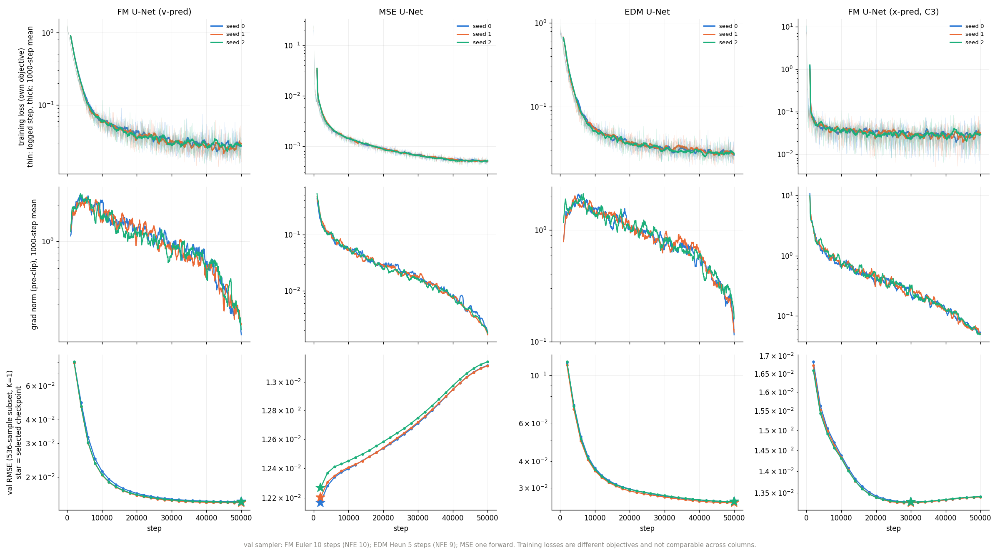
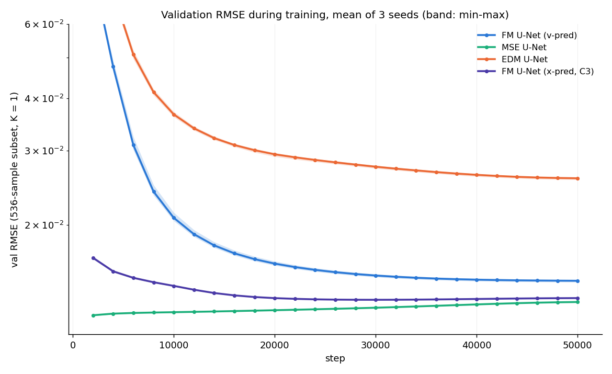
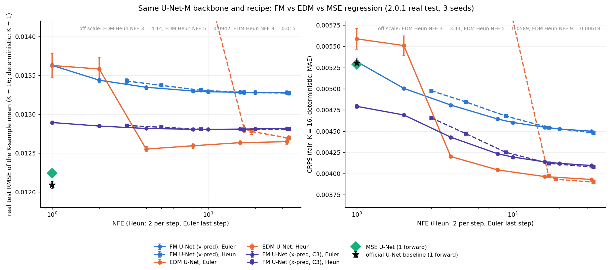

# 生成式模型的同骨架對照組（todo_D）：MSE 回歸與 EDM diffusion

- 期間：2026-10-13 ～ 10-14；機器：NCHC Nano4，全部 H200
- 任務清單：`todo_D_baselines.md`；決策：`docs/DECISIONS.md` D-043 ～ D-050
- 範圍：**U-Net 骨架（U-Net-M，38.8M）、real 訓練條件、3 個 seed**；評估 = 2.0.1 real test（4827 筆）、N_ar = 1
- 縮寫：`$D = /work/b314513067/pi-lfm/results/v2.0.1/baselines_D`

## 0. 結論

1. **「配方」（含骨架）沒有貢獻。** 同樣用確定性 MSE 回歸，我們的 2D U-Net-M 加上 FM 的訓練配方（EMA、bf16、AdamW、batch 64、50k 步），和官方 3D U-Net 幾乎一樣：test RMSE 0.01224 vs 0.01209（+1.2%），Rel L2 0.0624 vs 0.0620，CRPS（= MAE）0.00529 vs 0.00530。FM 和官方 baseline 的差距**不是**訓練配方造成的。
2. **生成式建模在點誤差上吃虧，在機率指標上佔優。** 相對於同骨架的 MSE 回歸：
   - RMSE / Rel L2 一律較差：FM（v-pred，Euler 20）單一樣本 +20%，16 個樣本平均 +8.5%；x-pred FM 是 +9.5% / +4.7%；EDM（Heun 19）是 +30% / +4.4%。
   - **CRPS 一律較好**：FM −14%、x-pred FM −22%、EDM −26%。
   - 也就是說，以 RMSE 為主的 benchmark 協議天生對生成式模型不利；如果看重機率預報的品質，三個生成式模型都贏過回歸。
3. **相同骨架、相同 NFE 下，EDM 優於 FM（v-pred）**：NFE 約 20 時，K-mean RMSE 0.01278 vs 0.01328（−3.8%），CRPS 0.00393 vs 0.00453（−13%），SSR 0.78 vs 0.51（ensemble 比較接近校準）。和 x-pred FM 相比，RMSE 打平（0.01278 vs 0.01281），CRPS 好 4.6%。
4. **但 EDM 在低 NFE 很脆弱**：Heun 在 NFE 3 / 5 / 9 會發散（RMSE 4.1 / 0.094 / 0.015），Euler 在 NFE 1–2 也明顯變差。FM 從 NFE 1 起就穩定。
5. **所有生成式模型的 ensemble 都太窄**（SSR < 1）：FM v-pred 0.51、x-pred FM 0.33、EDM 0.70–0.78。
6. 頻譜誤差（FE）最好的是 MSE U-Net（30.0）和 x-pred FM（29–30），比官方 baseline（33.0）好；v-pred FM 和 EDM 在 39–49。

---

## 1. 設定

### 1.1 三種目標函數，同一個網路（Step 0、2a、3a）

程式：`fm/objectives.py`、`fm/train_fm.py`（`--objective {fm,mse,edm}`，預設讀 config 的 `train.objective`，沒有就是 `fm`，原行為不變）、`fm/wrapper.py`（`FMPredictor(objective=…)`）。config：`fm/configs/cylinder/unet_M.yaml`（FM）、`fm/configs/cylinder/D/unet_M_{mse,edm}.yaml`。

| | FM（現有） | MSE 回歸 | EDM（Karras 2022） |
|---|---|---|---|
| 網路 | `UNet2D`，base_ch 80，channel_mult 1-2-4-4，2 res blocks | 同左 | 同左，當作 F_θ |
| 參數量 | 38,797,740 | 38,797,740 | 38,797,740 |
| 網路輸入 | concat(y_t, c)，c = 20 個輸入幀 × 3 通道，在通道層級串接；時間 t 經 sinusoidal(1000 t) + MLP，對每個 ResBlock 做 scale-shift | y_t 通道全為 0，t = 0 | concat(c_in·x, c)（條件不乘 c_in），時間嵌入吃 c_noise = ln(σ)/4 |
| 訓練目標 | ‖v_θ − (y1 − y0)‖²，t ~ U(0, 1) | ‖net(0, 0, c) − y1‖² | λ(σ)‖D(y1 + σn; σ) − y1‖²，ln σ ~ N(−1.2, 1.2²)，λ = (σ² + σ_d²)/(σσ_d)² |
| preconditioning | – | – | c_skip = σ_d²/(σ²+σ_d²)，c_out = σσ_d/√(σ²+σ_d²)，c_in = 1/√(σ²+σ_d²) |
| 推論 | Euler 或 Heun，從 t = 0 積分到 1 | 一次 forward | Euler 或 Heun（Karras Alg. 1），σ 網格 ρ = 7，σ ∈ [0.002, 80] |
| 訓練中的 val sampler | Euler 10 步（NFE 10） | 一次 forward | Heun 5 步（NFE 9，D-047） |

**共同的訓練配方**（三者完全相同）：real train 9063 筆、mask_prob 0.5、AdamW（lr 1e-4、wd 0、β = 0.9/0.999）、warmup 1000 + cosine、global batch 64、50k 步、clip 1.0、bf16 autocast、EMA（warmup 公式，上限 0.9999）；每 2000 步用 536 筆 val 子集、EMA 權重、K = 1 算 val RMSE，取最小的當 checkpoint。

**σ_d = 0.60**（D-045）：正規化後 real train 目標在 u、v 兩個通道合起來的 std（u 0.466、v 0.704）。全部通道一起算是 0.498，但 real 資料的 p 通道是常數，不代表訊號尺度。σ_max 維持 80（σ_max/σ_d ≈ 133，EDM 原文是 160）。統計：`$D/prep/target_stats.json`。

**EDM sanity check**（`scripts/D_prep.py sanity` → `$D/smoke/edm_sanity.json`）：
- 剛初始化的網路：σ = 80 時 D 的 rms 只有 0.012（≈ 0）；σ 很小時 D ≈ x。
- 訓練 400 步後：σ = 0.002 時 ‖D − x‖/‖x‖ = 0.0005；σ = 80 時 D 的平均是 0.0017（資料平均約 0），和目標的相對誤差 0.45（在估計條件均值）。preconditioning 行為正確。

### 1.2 評估（Step 1）

新腳本 `scripts/eval_prob.py`（舊的 `scripts/eval_fm.py` 不動，D-044）：

- 每個輸入抽 K 個樣本，噪聲用一個 seed 1234 的 generator 依序抽，所以不同模型拿到同一組噪聲（成對比較），K = 1 時和既有評估完全一致。
- 指標都在物理單位、量測通道（u、v）上：
  - **RMSE K=1** = 第 1 個樣本的 RMSE；**RMSE K-mean** = K 個樣本平均後的 RMSE；官方的 13 項指標兩者各算一次
  - **CRPS**（fair）= mean_i |x_i − y| − 1/(2K(K−1)) Σ_{i≠j} |x_i − x_j|，逐像素後平均；確定性模型是 MAE
  - **SSR** = √((K+1)/K) · spread / RMSE_Kmean，spread = 無偏 ensemble 變異數的平均再開根號
- 生成式模型 K = 16，MSE 和官方 baseline K = 1。
- **驗證**：FM U-Net s0（Euler 20、K = 1）和官方 U-Net s0 的 RMSE 都和 Phase 6 / Phase 4 的結果**逐位元相同**。過程中發現官方 N_ar 迴圈對預測有一次「反正規化 → 用 input 統計量再正規化 → 用 target 統計量反正規化」的往返，input 和 target 的統計量略有不同，預測會偏移約 1e-4；新腳本照官方做法處理（D-044）。確定性模型的 CRPS 0.0052740134 和官方 MAE 0.0052740132 一致。

**Step 1 要求的那一輪**（FM U-Net 3 seeds，K = 16，Euler NFE 1 和 10）：

| NFE | RMSE K=1 | RMSE K-mean | CRPS | SSR |
|---|---|---|---|---|
| 1 | 0.01733 ± 0.00010 | 0.01362 ± 0.00002 | 0.00531 | 0.84 |
| 10 | 0.01476 ± 0.00011 | 0.01328 ± 0.00003 | 0.00460 | 0.52 |

清單的備註預期 NFE 1 可能比 NFE 10 好。**v-pred FM U-Net 不是這樣**（NFE 1 的單一樣本 RMSE 比較差）。原因是 v-pred U-Net 在 t = 0 預測的條件均值還帶著很多和噪聲有關的殘差：K = 1 是 0.0173，16 個樣本平均後是 0.0136。x-pred FM 就符合這個預期（NFE 1：0.01298，NFE 10：0.01329），和週報 B4 的 DiT 結果一致。

### 1.3 Run 與 checkpoint

| 模型 | run 目錄 | 選出的 checkpoint（val 最佳） |
|---|---|---|
| FM U-Net（v-pred） | `results/fm/phase6/unet_M_real_{s0b,s1,s2}/best.pt`（Phase 6） | 50000 / 50000 / 50000 |
| FM U-Net（x-pred，補充） | `results/fm/c2/unet_xp_s{0,1,2}/best.pt`（週報 C3） | 30000 / 30000 / 30000 |
| MSE U-Net | `$D/runs/mse_unet_M_real_s{0,1,2}/best.pt` | **2000 / 2000 / 2000** |
| EDM U-Net | `$D/runs/edm_unet_M_real_s{0,1,2}/best.pt` | 50000 / 50000 / 50000 |
| 官方 U-Net baseline | Phase 4 的 real s0/s1/s2（報告 §5.3：model_6800 / 6000 / 6600） | – |

job：訓練 535531（1 h 44 m，6 張卡），評估 535554、535849；每個 job 的指令清單在 `jobs/lists/D_*.txt`。

---

## 2. 訓練曲線

（`scripts/D_summary.py curves` → `$D/curves.png`。各欄的 training loss 是各自的目標函數，彼此不能比較。★ 是選出的 checkpoint。）

- **MSE U-Net**：val 在第一個評估點（第 2000 步，warmup 剛結束）就是最好的（0.01217–0.01227），之後一路緩慢變差，到 50k 步是 0.0131；train loss 持續下降到 5e-4。也就是**回歸模型在這個預算下很快就過擬合**：第 2000 步時已經看過 12.8 萬個樣本，比官方 baseline 的整個預算（12 萬）還多。真正的最佳點可能在 2000 步之前，但選點規則照清單不改（每 2000 步評估一次），所以 MSE 的數字可能略為低估它的能力（D-050）。
- **EDM U-Net**：收斂最慢，val 到第 50k 步仍在下降（best = last）。訓練中的 val 用 Heun 5 步（NFE 9），正好落在 EDM 不穩定的低 NFE 區，所以 val 曲線（0.026）比 test 在 NFE ≥ 17 的表現（0.0127）差很多；三個 seed 選到的都是最後一步，所以選點不受影響。
- **FM**：v-pred 到 50k 步仍在改善；x-pred 在 30k 步最好，之後微幅變差。
- 所有 run 的 grad norm 都平穩，沒有發散（clip 前的最大值：MSE 0.3、EDM 6–7、x-pred FM 4.5–5.3；v-pred FM 的 log 只記錄單一步，最大 5.9–7.5）。

---

## 3. 主表（Step 4）

2.0.1 real test、3 seeds（mean ± std）。每個模型取「預設 NFE」（D-048）：FM = Euler 20（Phase 6 的測試設定）；EDM = Heun 10 步（NFE 19，原生 sampler 下最接近 20）。

| 模型 | sampler（NFE） | K | RMSE K=1 | RMSE K-mean | Rel L2 K=1 | Rel L2 K-mean | CRPS | SSR | FE K=1 / K-mean |
|---|---|---|---|---|---|---|---|---|---|
| 官方 U-Net baseline（3D、23.0M） | 1 forward | 1 | 0.01209 ± 0.00004 | – | 0.0620 ± 0.0003 | – | 0.00530 ± 0.00006 | – | 33.0 |
| **MSE U-Net**（同骨架回歸） | 1 forward | 1 | 0.01224 ± 0.00003 | – | 0.0624 ± 0.0002 | – | 0.00529 ± 0.00002 | – | **30.0** |
| FM U-Net（v-pred） | Euler 20 | 16 | 0.01473 ± 0.00012 | 0.01328 ± 0.00002 | 0.0826 ± 0.0012 | 0.0685 ± 0.0002 | 0.00453 ± 0.00001 | 0.51 | 48.9 / 39.5 |
| **EDM U-Net** | Heun 10 步（19） | 16 | 0.01586 ± 0.00006 | **0.01278 ± 0.00004** | 0.0871 ± 0.0003 | 0.0659 ± 0.0002 | **0.00393 ± 0.00000** | **0.78** | 46.0 / 40.3 |
| FM U-Net（x-pred，補充） | Euler 20 | 16 | 0.01340 ± 0.00001 | 0.01281 ± 0.00001 | 0.0691 ± 0.0000 | 0.0652 ± 0.0001 | 0.00412 ± 0.00001 | 0.33 | 30.1 / 29.2 |

**各模型最好的 NFE**

| 模型 | 依 K-mean RMSE | 依 CRPS |
|---|---|---|
| FM U-Net（v-pred） | Heun NFE 33：0.01327 | Heun NFE 33：0.00448 |
| EDM U-Net | **Euler NFE 4：0.01255**（CRPS 0.00420） | Heun NFE 33：**0.00390** |
| FM U-Net（x-pred） | Heun NFE 17：0.01280 | Heun NFE 33：0.00408 |

完整表（每個模型 × sampler × NFE，所有指標的 3-seed mean ± std）：`$D/summary.csv`；主表：`$D/main_table.md`；每個 checkpoint × 設定一個 JSON：`$D/eval/<run>_<sampler><steps>_K<K>.json`。

---

## 4. RMSE / CRPS vs NFE

（`scripts/D_summary.py summary` → `$D/pareto.png`。EDM Heun 在 NFE 3 / 5 / 9 超出範圍，數值標在圖的右上角。）

| NFE | FM v-pred Euler | EDM Euler | EDM Heun | FM x-pred Euler |
|---|---|---|---|---|
| 1 | 0.01363 / 0.00532 | 0.01363 / 0.00559 | – | 0.01289 / 0.00479 |
| 2 | 0.01344 / 0.00500 | 0.01358 / 0.00551 | – | 0.01285 / 0.00469 |
| 3 | – | – | **4.14 / 3.44（發散）** | – |
| 4 | 0.01335 / 0.00481 | **0.01255** / 0.00420 | – | 0.01282 / 0.00443 |
| 5 | – | – | **0.094 / 0.059（發散）** | – |
| 8 / 9 | 0.01330 / 0.00464 | 0.01259 / 0.00404 | 0.01496 / 0.00618（NFE 9） | 0.01281 / 0.00423 |
| 16 / 17 | 0.01328 / 0.00455 | 0.01263 / 0.00397 | 0.01281 / 0.00397（NFE 17） | 0.01281 / 0.00414 |
| 32 / 33 | 0.01328 / 0.00450 | 0.01265 / 0.00393 | 0.01269 / **0.00390**（NFE 33） | 0.01282 / 0.00410 |

（每格是 K-mean RMSE / CRPS，3-seed 平均。FM 的 Heun 和 Euler 在相同 NFE 下幾乎一樣，表中省略，見 `summary.csv`。）

- **FM**：K-mean RMSE 在 NFE 8 之後就持平，CRPS 隨 NFE 緩慢改善。Heun 沒有比 Euler 好。
- **EDM Euler**：NFE 1–2 差（每樣本 RMSE 0.0136，FE 約 130，過度平滑），**NFE 4 起就是所有模型裡 K-mean RMSE 最低的**（0.01255–0.01265）。
- **EDM Heun 在低 NFE 會發散**：ρ = 7 的網格在只有 2–3 步時，第一步從 σ = 80 直接跳到很小的 σ。Heun 的第二次評估是在一個「被一步拉到接近乾淨、但還是模糊的平均場」上，用很小的 σ 呼叫 D，這種輸入在訓練時從沒出現過，修正項被放大。NFE ≥ 17 之後正常。
- 在 RMSE 上，所有生成式模型都追不上兩個確定性模型（MSE 0.01224、官方 0.01209）；最接近的是 EDM Euler NFE 4（+2.5%）。

---

## 5. 2×2 分解

Rel L2 和 CRPS 越低越好。「配方」= MSE U-Net − 官方 U-Net；「生成式建模」= 生成式模型 − MSE U-Net。

| 貢獻 | Rel L2（K=1 / K-mean） | CRPS |
|---|---|---|
| **配方（＋骨架）** = MSE U-Net − 官方 U-Net | +0.0003 | −0.00001 |
| **生成式（FM v-pred，Euler 20）** = FM − MSE | +0.0203 / +0.0062 | **−0.00076**（−14%） |
| 生成式（FM x-pred，Euler 20） | +0.0067 / +0.0028 | **−0.00117**（−22%） |
| 生成式（EDM，Heun 19） | +0.0247 / +0.0036 | **−0.00136**（−26%） |

各項的絕對值：官方 U-Net Rel L2 0.0620、CRPS 0.00530；MSE U-Net 0.0624、0.00529（`$D/decomposition.md`）。

**解讀**
- 配方的貢獻是 0（兩項都在 seed 的雜訊內）。注意這一項同時包含架構差異（官方是 3D U-Net、23.0M；我們是 2D U-Net-M、38.8M），兩者在這個任務範圍內無法分開（D-049）。結論是：**換骨架加換配方，對確定性回歸沒有幫助，也沒有傷害。**
- 生成式建模在 Rel L2 上是負貢獻（變差），在 CRPS 上是正貢獻（變好）。K 個樣本平均能收回大部分的 Rel L2 差距（v-pred：+0.0203 → +0.0062），但收不完：FM 的條件均值本身就比回歸差（和 Phase 6 的 K 拆解一致）。
- 所以，Phase 6 裡「FM 比 baseline 差」的結論，在換成 CRPS 時會反過來。

---

## 6. 異常與註記

1. **MSE 的選點在第一個評估點**（第 2000 步，所有 seed）。val 之後單調變差，真正的最佳點可能更早。照清單「選點規則不改」，沒有加密評估。這個偏差只會讓 MSE 看起來略差，不改變「配方貢獻 ≈ 0」的結論（D-050）。
2. **EDM 的 val sampler（Heun NFE 9）落在不穩定區**，val 數字（0.026）不代表它在 test 上的表現。三個 seed 都選到最後一步，所以不影響結果；下次用 EDM 時，val 應該改用 Euler NFE 8 或 Heun NFE ≥ 17。
3. **EDM Heun 低 NFE 發散**是 sampler 的特性，不是訓練問題（同一個 checkpoint 在 Euler NFE 4 是最好的模型）。報告 EDM 時必須連同 sampler 和 NFE 一起寫。
4. **SSR 都 < 1**：三個生成式模型的 ensemble 都太窄，x-pred FM 最嚴重（0.33；它在 NFE 1 幾乎是確定性的）。EDM 最接近校準（0.70–0.78）。
5. GPU：全部在 H200 上（清單寫 H100 或 L40S，叢集沒有）；同一批比較用同一種卡（D-043）。

---

## 7. 下一步（尚未執行）

- DiT 骨架的同樣對照（清單說 C 部分選出穩定設定後再開；設定已選定：x-pred + patch 4 + QK-norm）。
- 如果要以 RMSE 為主要指標，EDM Euler NFE 4 值得進一步看；如果以 CRPS 為主，EDM Heun NFE 33 和 x-pred FM 都是候選。
- MSE 回歸的選點在更密的評估網格下重做（例如每 250 步），確認最佳點的位置。
