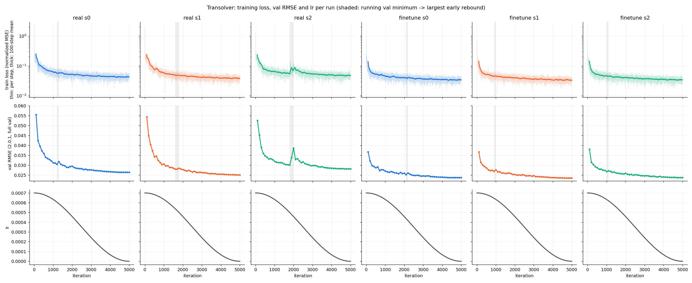
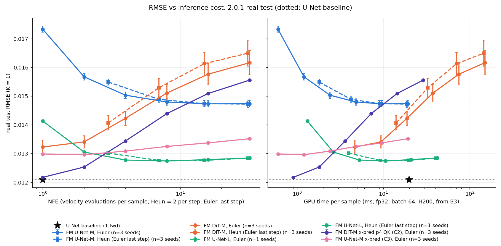
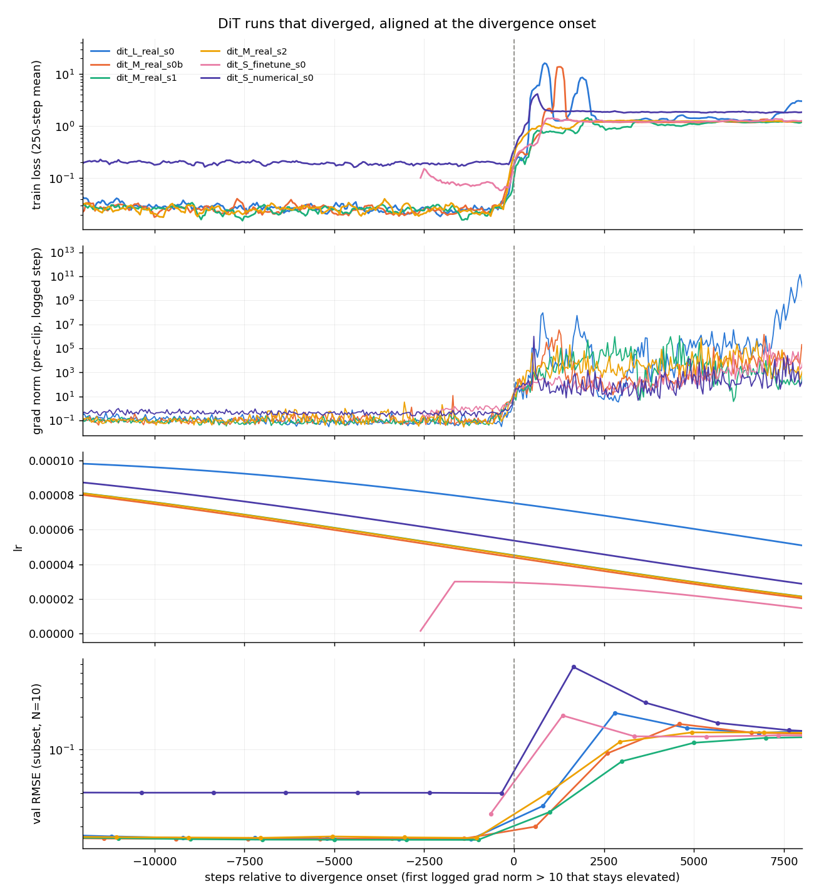
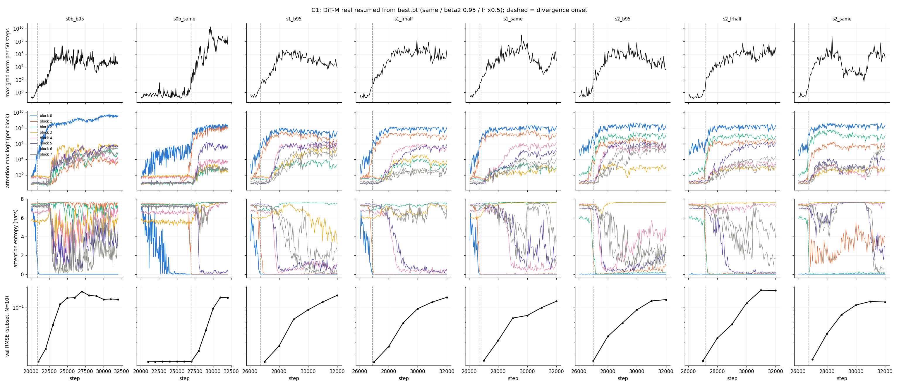
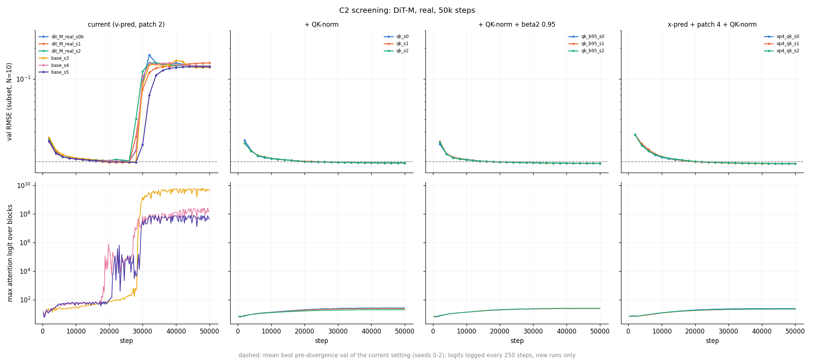

# 2026-10-12 週報告：Transolver 回升、FM 成本、DiT 發散

- 期間：2026-10-12 起；機器：NCHC Nano4（全部 H200）；任務清單：`todo_1012.md`
- 決策：`docs/DECISIONS.md` D-032 起
- 縮寫：`$R = /work/b314513067/pi-lfm/results`，`$F = $R/fm`。FM 的 run 目錄是 `$F/phase6/<run>/`，對應的報告是 `docs/reports/step_6.4_fm_results.md`
- 程式：本週新增或修改的檔案列在每一節的「產出」

## 0. 摘要

1. **Transolver 的回升（A）**：6 個 run 裡只有 real s2 有實質回升（1800→2000 步，val +29%）。同一段 train loss 也上升 43% 並出現 spike，判定為**最佳化不穩**（lr 7e-4、沒有 warmup、沒有 clipping）。其餘 5 個 run 只是 ≤4.5% 的單點跳動。所有 run 的最佳點都在第 5000 步，不影響報告數字。A2 不需要做（D-032）。
2. **成本（B）**：清單原本的前提「U-Net baseline 的 wall-clock 主要花在資料載入」**不成立**。官方 U-Net 是 3D U-Net，**每個樣本 forward 約 1.1 TFLOPs**，用合成 tensor 量到的 step time（0.687 s）和 as-run 的 0.688 s/iter 一樣。FM U-Net-M 每次 NFE 是 54 GFLOPs，所以 **NFE 20 的總計算量大約等於 baseline 的一次 forward**。推論時間：FM U-Net-M 在 NFE 20 約 12 ms/樣本，baseline 約 20 ms/樣本（fp32、batch 64）。
3. **DiT 的「回升後降不回去」（C）其實是訓練發散**，只發生在 real 設定（DiT-M 3/3 個 seed，發散起點 27.0k–27.4k 步）。機制是 **attention logit 增長（H1）**：第 0 層的 attention logit 先暴增到 10⁵–10⁸，entropy 降到 0（one-hot attention），之後 grad norm 才爆炸，然後其他層跟著崩潰。U-Net FM 沒有這個現象。
4. **C2 篩選**：現行設定 **6/6 個 seed 發散**（27.0k–29.3k 步）；加上 QK-norm 的三個設定都是 **0/3 發散**，最終 val 都優於現行設定發散前的最佳值。x-pred + patch 4 + QK-norm 最好（test RMSE N20 K1 0.01525 ± 0.00003，原本 0.01592 ± 0.00039），而且訓練快 3 倍。
5. **C3**：x-pred 對 U-Net 也有效（test RMSE N20 K1 0.01473 → **0.01340**，FE 48.7 → 30.0，優於 baseline 的 33.1），所以 x-pred 的改善主要來自參數化方式，不是 backbone。
6. **從發散前的 checkpoint 續訓（C1）**：在 26k 步時狀態已經接近臨界，相同設定、β2 0.95、lr 減半都在 750–1200 步內發散；20k 步的 checkpoint 用相同設定續訓到 26k 步沒有發散，但第 0 層的 entropy 已經降到 0。也就是說，**事後調 optimizer 無效，要從架構上限制 logit**。

---

## A. Transolver real / finetune 在約 2000 步的 val 回升

**方法**（`scripts/transolver_rebound.py`）：每個 run 一欄，三個面板共用 x 軸：train loss（checkpoint 裡逐步的 `train_losses`，細線是逐步的值，粗線是 100 步平均）、2.0.1 val RMSE（每 100 步）、lr(t)（官方 Adam + `CosineAnnealingLR(T_max=5000)`，每步更新，沒有 warmup，沒有 clipping）。real s0 是 2.0.0 時期的 run（D-017），checkpoint 裡存的 val 是舊 val，所以改用 Step 3.4 在 2.0.1 上重評的曲線。

**回升的定義**：前 4000 步裡，某個 val 點相對它之前的最低點升高最多的那一次。

| run | 回升前最低點（步, RMSE） | 回升點（步, RMSE） | 回升 | train loss（100 步平均）：最低點 → 回升點 | 該段 spike（> 3 × 局部中位數） | lr | 最佳點 |
|---|---|---|---|---|---|---|---|
| real s0 | 1200, 0.0305 | 1300, 0.0318 | +4.5% | 0.0573 → 0.0580 | 0 | 6.0e-4 | 5000, 0.0264 |
| real s1 | 1600, 0.0280 | 1800, 0.0286 | +2.1% | 0.0485 → 0.0489 | 0 | 5.0e-4 | 5000, 0.0251 |
| **real s2** | 1800, 0.0301 | **2000, 0.0387** | **+28.6%** | **0.0546 → 0.0779** | 1 | 4.6e-4 | 5000, 0.0282 |
| finetune s0 | 2100, 0.0253 | 2200, 0.0261 | +3.2% | 0.0397 → 0.0409 | 0 | 4.2e-4 | 5000, 0.0237 |
| finetune s1 | 900, 0.0270 | 1000, 0.0277 | +2.6% | 0.0451 → 0.0455 | 0 | 6.3e-4 | 5000, 0.0235 |
| finetune s2 | 1000, 0.0268 | 1100, 0.0272 | +1.5% | 0.0463 → 0.0454 | 0 | 6.2e-4 | 5000, 0.0238 |

**判讀**（照清單的規則）：
- real s2：train loss 在同一段上升 43%，並且有 spike → **最佳化不穩（lr）**。lr 從 2400 步左右開始降低，val 就回到原本的趨勢。
- 其餘 5 個 run：回升 ≤ 4.5%，train loss 沒有同步變化，屬於 lr 還很高時 checkpoint 之間的正常跳動，不是泛化問題。
- 只有 1/6 個 run 出現，屬於**隨機性**（依 seed 而定）。
- 結論（報告用的一句話）：**Transolver 在 ~2000 步的回升只在 real s2 明顯，伴隨 train loss spike，是高 lr（7e-4、無 warmup）下的最佳化不穩；lr 降下來後回穩，最佳點都在第 5000 步，報告數字不受影響。**
- A2 不做（D-032）。

產出：`$R/v2.0.1/transolver_rebound/{overlay.png, summary.json, summary.md}`

---

## B. FM vs U-Net：訓練與推論成本

### B1 as-run 成本（`scripts/cost_asrun.py` → `$R/cost/asrun.{csv,md}`）

baseline 的時間來自 TensorBoard `train_loss` 逐步的 `wall_time`；FM 的時間來自 `log.jsonl` 每 50 步記錄的 `it_per_s`，再用 sacct 的 job 時間核對（差異 < 2%）。

| 方法 | 設定 | 精度, batch | s/iter | samples/s | GPU-h：完整預算 / 到選定 ckpt | 看過的樣本：預算 / 到選定 ckpt |
|---|---|---|---|---|---|---|
| U-Net baseline（官方，n=3） | real | fp32, 12 | 0.688 | 17 | 3.85 / 2.48 | 0.12M / 0.077M |
| U-Net baseline（官方，n=3） | finetune | fp32, 12 | 0.690 | 17 | 4.11 / 2.57 | 0.12M / 0.075M |
| Transolver（官方） | real s1 | fp32, 16 | 0.613 | 26 | 2.54 / 2.54 | 0.08M |
| FM U-Net-M（n=3） | real | bf16, 64 | 0.108 | 598 | 1.67 / 1.67 | 3.2M / 3.2M |
| FM DiT-M（n=3） | real | bf16, 64 | 0.181 | 354 | 2.83 / 1.36 | 3.2M / 1.54M |
| FM U-Net-L | real s0 | bf16, 64 | 0.195 | 328 | 2.94 / 2.01 | 3.2M / 2.18M |
| FM DiT-L（2 卡 DDP） | real s0 | bf16, 64 | 0.207 | 309 | 6.93 / 2.25 | 3.2M / 1.02M |

- FM 看過的樣本數是 baseline 的 **27 倍**（320 萬 vs 12 萬），但 GPU 時間反而比較少：FM U-Net-M 1.67 GPU-h，baseline 3.85 GPU-h。
- finetune 要加上預訓練的成本：baseline numerical 4.55 GPU-h；FM U-Net-M numerical 1.5–1.8 GPU-h（50k 步）。

### B2 + B3 模型成本與受控 benchmark（`scripts/bench_cost.py` → `$F/b3_bench/bench.json`）

全部模型在**同一個 job、同一張 H200**（job 531170）上測。合成 tensor，不經 dataloader。先 warmup 10 次，再用 CUDA event 計時 30 次，取中位數。FLOPs 用 `torch.utils.flop_counter`，算 batch 1、64×128 的一次 forward（FM 是一次 NFE）。

| 模型 | 參數 | GFLOPs / forward | 受控訓練（bf16）：batch, ms/step, samples/s, peak GB | 推論 fp32：batch 1 延遲 ms / batch 64 forward/s | 推論 bf16：batch 1 ms / batch 64 forward/s |
|---|---|---|---|---|---|
| U-Net baseline（官方 3D U-Net） | 23.0M | **1112** | 16, 1866, 9, 80（batch 64 和 32 會 OOM）；**fp32 batch 12：687 ms, 17 samples/s** | 39.5 / 51 | 65.1 / 23 |
| Transolver（官方） | 4.3M | 1401 | 32, 1268, 25, 81 | 17.8 / 83 | 12.2 / 88 |
| DeepONet（官方） | 3.5M | 56 | 64, 138, 465, 49 | 2.9 / 510 | 2.0 / 1124 |
| FM U-Net-Sv2 | 9.3M | 20 | 64, 70, 910, 10 | 5.6 / 2296 | 8.2 / 2444 |
| FM U-Net-M | 38.8M | 54 | 64, 95, 670, 14 | 5.8 / 1664 | 8.4 / 1759 |
| FM U-Net-L | 125.4M | 173 | 64, 190, 336, 26 | 6.5 / 760 | 8.3 / 891 |
| FM DiT-S | 9.9M | 61 | 64, 89, 717, 14 | 3.7 / 535 | 3.8 / 2014 |
| FM DiT-M | 39.1M | 173 | 64, 178, 360, 26 | 6.5 / 214 | 3.7 / 1015 |
| FM DiT-L | 119.4M | 463 | 64, 386, 166, 54 | 14.6 / 86 | 4.8 / 475 |
| FM DiT-M + QK-norm（C2 設定 2、3） | 39.1M | 173 | 64, 242, 265, 38 | 6.8 / 204 | 4.8 / 742 |
| FM DiT-M x-pred patch 4 + QK-norm（C2 設定 4） | 40.2M | 32 | 64, 60, 1071, 11 | 3.2 / 1108 | 5.0 / 3020 |

**重點**
- **清單的前提「baseline 的時間主要花在資料載入」不成立**：官方 U-Net 用合成 tensor 的 step time（fp32、batch 12：0.687 s）和 as-run（0.688 s/iter）相同，所以時間花在模型本身。它是 3D U-Net（時間也當成一個卷積維度），每個樣本 forward 1.1 TFLOPs，是 FM U-Net-M 一次 NFE 的 20 倍。
- 官方 U-Net 在 bf16 下**比 fp32 慢**（訓練 9 vs 17 samples/s，推論 batch 1 65 vs 40 ms），batch 32 以上會 OOM。所以它的「受控」數字取 fp32 batch 12 比較合理。
- **推論成本**（每個樣本，fp32、batch 64）：baseline 1 次 forward = 19.6 ms。FM U-Net-M 每次 NFE 0.60 ms，NFE 20 = 12 ms，K = 5 是 60 ms；FM DiT-M 每次 NFE 4.7 ms（fp32 的 attention 走 math kernel，很慢），NFE 20 = 93 ms。DiT 在 bf16 下快 4.7 倍（1015 forward/s），報告的評估都用 fp32，B4 的時間軸也用 fp32。
- **訓練成本**（每個樣本）：baseline 57 ms（fp32），FM U-Net-M 1.5 ms（bf16），差約 38 倍。所以 FM 看了 27 倍的樣本，GPU 時間還是比較少。
- QK-norm 讓 DiT-M 的訓練慢 36%，記憶體多 46%（RMSNorm 的額外記憶體讀寫）。x-pred + patch 4 的 token 數只有 1/4，訓練快 3 倍。

### B4 RMSE vs NFE 的 Pareto 圖（`scripts/eval_fm.py` + `scripts/cost_summary.py pareto` → `$R/cost/pareto.{png,csv}`）

2.0.1 real test（4827 筆）、K = 1、噪聲 seed 1234、EMA best.pt（D-038）。Euler NFE {1, 2, 4, 8, 16, 32}；Heun 用**最後一步改 Euler** 的版本（步數 2/4/8/16 → NFE 3/7/15/31，D-039）。最早跑的 Heun 在最後一步會評估 t = 1，有偏差（例如 U-Net-M 1 步 0.098），只留在 CSV 裡。右圖的時間 = NFE × B3 量到的每次 forward 時間（fp32、batch 64）。另外加上 C2 的 x-pred DiT（3 seeds，第 50000 步，沒有發散）。job 531149、531317、531322。

| 模型 | NFE 1 | 2 | 4 | 8 | 16 | 32 | 最佳（NFE） | 最佳點的時間 / 樣本 |
|---|---|---|---|---|---|---|---|---|
| U-Net baseline（確定性，1 次 forward） | 0.01209 | | | | | | 0.01209 | 19.6 ms |
| FM U-Net-M（3 seeds） | 0.01734 | 0.01568 | 0.01504 | 0.01480 | 0.01473 | 0.01474 | 0.01473（16） | 9.6 ms |
| FM U-Net-L（seed 0） | 0.01414 | 0.01305 | 0.01278 | 0.01274 | 0.01279 | 0.01285 | 0.01274（8，+5.4%） | 10.5 ms |
| FM DiT-M（v-pred，3 seeds，發散前的 ckpt） | **0.01323** | 0.01341 | 0.01423 | 0.01511 | 0.01577 | 0.01617 | 0.01323（1） | 4.7 ms |
| FM DiT-M x-pred patch 4 + QK-norm（C2，3 seeds） | **0.01217** | 0.01253 | 0.01344 | 0.01439 | 0.01509 | 0.01556 | **0.01217（1，+0.7%）** | **0.9 ms** |
| FM U-Net-M x-pred（C3，3 seeds） | 0.01299 | 0.01296 | 0.01309 | 0.01325 | 0.01337 | 0.01352 | 0.01296（2，+7.2%） | 1.2 ms |

Heun（Euler 最後一步），NFE 3 / 7 / 15 / 31：U-Net-M 0.01549 / 0.01489 / 0.01474 / 0.01473；U-Net-L 0.01302 / 0.01276 / 0.01276 / 0.01284；DiT-M 0.01407 / 0.01530 / 0.01613 / 0.01650。**在相同 NFE 下，Heun 沒有比 Euler 好。**

**重點**
- **v-pred U-Net 和其他模型的趨勢相反**：v-pred U-Net 的 RMSE 隨 NFE 下降，NFE 8 之後持平；DiT（v-pred、x-pred）和 x-pred U-Net 的 RMSE 隨 NFE **上升**或持平，NFE 1–2 最好。
- **NFE 1 的 Euler 等於條件均值的估計**：一步 Euler 是 y = y0 + v(y0, 0, c)，而 t = 0 時最佳的 v 是 E[y1 | c] − y0，所以輸出就是 E[y1 | c]，和噪聲無關，是一個確定性的回歸預測。DiT 在 NFE 1 最好，表示它學到的條件均值不錯，但積分越多步，樣本的變異和誤差越大（RMSE 偏好平滑的條件均值，見 Phase 6 觀察 6）。U-Net 在 t = 0 的預測反而差（0.0173），要積分幾步才變好。
- **x-pred DiT 在 NFE 1 時 RMSE 0.01217，和 U-Net baseline（0.01209）只差 0.7%，每個樣本只要 0.9 ms**，baseline 要 19.6 ms。不過這是「當成回歸模型用」的結果，不代表生成的樣本品質；這正好是 D 節「同骨架確定性回歸對照組」要回答的問題。
- 對主表的影響：主表用 N = 20，對 DiT 不利（v-pred DiT-M 在 NFE 1 是 0.0132，N = 20 是 0.0159）。**FM 的 RMSE 要和 NFE 一起報告**，不能只報一個 N。
- 以時間來看，FM U-Net-L 在 NFE 4–8（5–10 ms）就達到 0.0128，比 baseline 便宜，但 RMSE 還是差 5%。

---
## C. DiT 的 val RMSE 回升後降不回去

### 先修正現象的描述（D-033）

清單寫的是「三種訓練條件裡，每種都有 1–2 個 seed 的 val RMSE 回升，之後就降不回去」。逐 run 讀 log 之後（`scripts/c_stability.py align` → `$F/c_stability/divergence_table.md`），實際上是兩個不同的現象：

| 現象 | 發生在哪裡 | train loss | 是不是 DiT 特有 |
|---|---|---|---|
| **P1 訓練發散** | DiT-M **real 3/3 個 seed**（27.0k–27.4k 步）、DiT-L real（17.2k）、DiT-S numerical（24.4k）、DiT-S finetune（2.7k） | 從約 0.02 跳到約 1.2（等於初始值），grad norm 10³–10⁸，**不會恢復** | 是：所有 U-Net FM run（M/L/Sv2，3 種設定）都沒有發散 |
| P2 numerical 的 val 慢慢變差 | DiT-M numerical 3/3（2k 步之後）、U-Net-M numerical 3/3（22k 之後）、U-Net-L numerical | 平順下降 | 否：U-Net FM 和官方 baseline 都有（Step 3.4 的 early peak，sim→real 的落差） |

DiT-M 的 numerical 和 finetune 都沒有發散（0/3）。**C 以 P1 為主軸**，P2 只在 C0 裡當對照。

**報告註記仍然成立**：DiT real 的測試數字來自發散前由 val 選出的 checkpoint（20k–26k 步），等於提早停止的模型。

### C0.1 U-Net FM 有沒有同樣的發散？→ 沒有

U-Net-M（3 種設定 × 3 seeds）、U-Net-L、U-Net-Sv2 都沒有發散：grad norm 一直 < 2.5，train loss 單調下降。U-Net 的 val 回升只有 P2（numerical）。**問題鎖定在 Transformer 本身（H1）**，H2 的嫌疑變小。

### C0.2 對齊回升的那一步

發散起點定義為「第一個 grad norm > 10，而且之後 10 個記錄點的中位數 > 1」（只出現一次的 spike 算前兆）。

| run | 發散起點 | 當時的 lr | 發散前 grad norm 中位數 | 發散前 grad norm > 1 的比例 | best.pt 的步數 |
|---|---|---|---|---|---|
| DiT-M real s0b | 27400 | 4.4e-5 | 0.144 | 0.9% | 20000 |
| DiT-M real s1 | 27000 | 4.5e-5 | 0.130 | 2.4% | 26000 |
| DiT-M real s2 | 27050 | 4.5e-5 | 0.177 | 2.0% | 26000 |
| DiT-L real s0 | 17200 | 7.5e-5 | 0.120 | 0.0% | 16000 |
| DiT-S numerical s0 | 24350 | 5.4e-5 | 0.536 | 9.4% | 24000 |
| DiT-S finetune s0 | 2650 | 2.9e-5 | – | – | 2000 |

- **發散前 train loss 和 grad norm 都很平順**，clipping（1.0）幾乎從不觸發（< 2.5% 的記錄點）。發散是突然發生的：幾百步內 grad norm 從 0.1 升到 10²，接著 10⁴ 以上，loss 回到約 1.2 之後就停在那裡。
- 和判讀表對照：「回升前後有 spike，clip 頻繁觸發」只有一半符合，**是 spike 但不是事先頻繁 clip**。train loss 本身發散，直接排除 H2（train loss 平順）和 H3（train loss 持續下降）。
- 發散時 lr 已經在 cosine 的後半段（4.4e-5 到 7.5e-5），**不是 lr 最高的時候**。

產出：`$F/c_stability/{divergence_table.md, divergence_table.json, aligned_divergence.png}`

### C0.7 同一個 seed 在不同條件下、不同 seed 在同一條件下

- DiT-M real 三個 seed 的資料順序不同，發散起點卻都在 **27.0k–27.4k 步**。
- C1 的 s0b 從 20000 步續訓，資料順序和原本不同（loader 的 RNG 沒有存），發散在 **26950** 步，原本的 run 是 27400 步。
- DiT-S finetune 的起點是 DiT-S numerical **第 24000 步**的 checkpoint（那個 run 在 24350 步發散），finetune 在 2650 步內就發散。DiT-M 和 DiT-L finetune 的起點是 numerical 第 2000 步，20k 步都很穩定。

→ **發散是由累積在權重裡的狀態觸發的，不是特定 batch。** 發散的步數大致由「訓練了多少」決定，起點已經接近臨界的話，在新的條件下也會很快發散。

### C1 從發散前的 checkpoint 續訓（D-036）

`best.pt` 存有 optimizer state，所以可以續訓。8 個 run，lr 排程維持 50k 總長，續訓到 32000 步，每 50 步記錄 attention 統計（用訓練 batch 的前 4 筆，t 隨機）。

| 起點 | 變體 | 第 0 層 entropy 第一次 < 1 nat | 發散起點 | val（續訓後 1k 步 → 6k 步） |
|---|---|---|---|---|
| s0b @ 20000 | 相同 | 21150 | **26950** | 0.0152 → 0.0154（到 27k 都正常）→ 32k 時 0.141 |
| s0b @ 20000 | β2 0.95 | 20950 | **20900** | 0.0153 → 0.141 |
| s1 @ 26000 | 相同 | 26650 | 26750 | 0.0158 → 0.124 |
| s1 @ 26000 | β2 0.95 | 26600 | 26750 | 0.0153 → 0.153 |
| s1 @ 26000 | lr × 0.5 | 26800 | 26900 | 0.0151 → 0.143 |
| s2 @ 26000 | 相同 | 26050（起點就已崩潰） | 26750 | 0.0166 → 0.121 |
| s2 @ 26000 | β2 0.95 | 26050 | 27000 | 0.0157 → 0.132 |
| s2 @ 26000 | lr × 0.5 | 26050 | 27200 | 0.0156 → 0.182 |

1. **重現**：相同設定續訓，3/3 都在原本的步數附近發散（s0b 26950 vs 27400，s1 26750 vs 27000，s2 26750 vs 27050）。
2. **β2 0.95 和 lr 減半都沒用**：從 26000 步出發，6 個變體全部在 750–1200 步內發散，lr 減半只延後約 150–450 步。從 20000 步出發時，**換成 β2 0.95 反而讓發散提前了 6000 步**（20900 vs 26950）。原因可能是半途換 β2 時，舊的二階動差估計很快被小梯度覆蓋，有效步長變大。
3. **時間順序**（每一個 run 都一樣）：第 0 層（最靠近 patch embedding 的那一層）的 attention max logit 先增長到 10³–10⁵，entropy 從約 7 降到 0（one-hot attention）→ 幾百到幾千步之後 grad norm 才爆炸 → 其他層的 logit 跟著暴增、entropy 崩潰 → val 上升。s0b 相同設定那一個，第 0 層 entropy 在 21150 步就崩潰了，發散卻在 26950 步，**前兆比發散早了約 5800 步**。
4. **結論**：不穩定的根源是 attention logit 的增長（H1），事後調 optimizer 救不回來，要從架構上限制 logit 的大小（QK-norm），也就是 C2 的設定 2–4。

產出：`$F/c1_resume/<variant>/`（`log.jsonl` 含 `attn`、`wnorm` 紀錄）、`$F/c_stability/{c1_resume.png, c1_table.json}`；清單 `jobs/lists/c1_resume.txt`；job 531147。

### C0.3–C0.6 回升前後的 checkpoint（`fm/tests/diag_stability.py`）

每個 run 只有 `best.pt`（發散前，val 選出的點）和 `last.pt`（第 50000 步，發散後）兩個 checkpoint。對每個 checkpoint 的 EMA 和 raw 權重各算一次：536 筆 val 子集與 536 筆固定 train 樣本上，7 個固定 t 的 FM loss（同一組噪聲）；val RMSE（Euler N=10 = 訓練中的 val、Euler N=50、Heun 10 步 = NFE 20）；DiT 再加上 attention 統計（4 筆 val，t = 0.1 / 0.5 / 0.9）。job 531149（GPU 4、5）。

完整表：`$F/c_stability/c0_diag_table.md`（每個 checkpoint 一個 JSON：`$F/c0_diag/<run>__<ckpt>.json`）。摘要（EMA 權重；FM loss 是 val / train）：

| checkpoint | 步數 | val E10 / E50 / Heun10 | FM loss t=0.3 | FM loss t=0.98 | 第 0 層 max logit（t = 0.1 / 0.5 / 0.9） | 最低層 entropy（均勻 = 7.62） | adaLN scale 最大值 |
|---|---|---|---|---|---|---|---|
| DiT-M real s0b best | 20000 | 0.0153 / 0.0162 / 0.0173 | 0.0089 / 0.0079 | 0.172 / 0.163 | 27 / 42 / 72 | 5.86 | 0.67 |
| DiT-M real s1 best | 26000 | 0.0150 / 0.0160 / 0.0171 | 0.0084 / 0.0074 | 0.179 / 0.171 | 34 / 63 / 324（raw：28 / 141 / **12045**） | 6.07（raw 在 t=0.9：0.05） | 0.56 |
| DiT-M real s2 best | 26000 | 0.0157 / 0.0168 / 0.0178 | 0.0092 / 0.0081 | 0.239 / 0.231 | **10234**（t=0.5） | **0.00** | 0.81 |
| DiT-L real best | 16000 | 0.0152 / 0.0162 / 0.0173 | 0.0086 / 0.0077 | 0.177 / 0.169 | **16601 / 56074 / 345101** | **0.00** | 0.69 |
| DiT-M real s0b/s1/s2 last | 50000 | 0.132–0.143（三種 sampler 相同） | 1.22–1.31 / 1.19–1.28 | 1.25–1.33 | 10⁷–10⁸ | 0.00 | 25–80 |
| DiT-M finetune s0 last（穩定） | 20000 | 0.0167 / 0.0174 / 0.0185 | 0.013 / 0.0115 | 0.254 / 0.237 | 33（t=0.5） | 6.36 | 1.55 |
| DiT-S real last（穩定） | 50000 | 0.0171 / 0.0179 / 0.0189 | 0.0128 / 0.0114 | 0.221 / 0.207 | 54 | 6.15 | 1.12 |
| DiT-M numerical s0b best → last（P2） | 2000 → 50000 | 0.0387 → 0.0438 | 0.103 / 0.079 → **0.182 / 0.040** | 0.96 / 1.03 → 0.89 / 0.71 | 15 → 25 | 6.66 → 6.44 | 0.70 → 0.81 |
| U-Net-M real s0b last（對照） | 50000 | 0.0148 / 0.0148 / 0.0161 | 0.029 / 0.011 | 0.183 / 0.171 | – | – | – |
| U-Net-M numerical s0 best → last（P2） | 22000 → 50000 | 0.0331 → 0.0360 | 0.111 / 0.059 → 0.149 / 0.052 | 1.09 / 0.90 → 1.43 / 0.85 | – | – | – |

**判讀表**（清單的表，加上實測結果）

| 檢查 | H1 預期 | H2 預期 | H3 預期 | 實測（DiT 發散，P1） |
|---|---|---|---|---|
| train loss / grad norm | 回升前後有 spike，clip 頻繁觸發 | 平順 | 平順地持續下降 | 突然 spike 後發散，train loss 回到 1.2；**發散前 clip 幾乎不觸發** → H1（部分符合） |
| val FM loss（按 t 分段） | 全面上升 | 沒變差，或只有接近資料端的那段變差 | train/val gap 拉大 | 發散前 val/train 在各 t 都是約 1.15（和穩定的 DiT-S、finetune 一樣）；發散後**全面**升到約 1.2–1.3 → **H1** |
| 改用 NFE 50 / Heun | 仍然差 | 回升變小或消失 | 仍然差 | 發散後三種 sampler 完全一樣差（0.132 vs 0.133 vs 0.133）→ **非 H2** |
| attention 統計 | 某幾層 logit 暴增、entropy 驟降 | 正常 | 正常 | 第 0 層 logit 10³–10⁵、entropy 0，**在發散前就出現**；穩定的 run 各層 ≤ 55 → **H1** |

**結論：P1 是 H1（attention logit 增長 / entropy collapse）。** 細節：
- **C0.3**：發散前 DiT-M real 的 val/train 比值和穩定的 run 一樣，沒有過擬合（H3 排除）。順帶一提，U-Net-M real 的 val/train gap 反而比較大（t=0.3：2.7 倍），但它的 val RMSE 一直在改善，所以 FM loss 的 gap 不能直接拿來判斷取樣品質。
- **C0.4 EMA vs raw**：發散前兩者的 val RMSE 只差 ±2%。EMA 的 logit 增長落後 raw（s1：t=0.9 時 324 vs 12045），等於把發散延後一點，但擋不住；發散後兩者一樣差。val 一直用 EMA，曲線不會掩蓋發散。
- **C0.5**：**logit 增長和 t 有關，越接近資料端（t → 1）越大**（s1 raw：t=0.1 時 28，t=0.9 時 12045）。q/k 投影權重的 norm 只溫和增加（19 → 23–29），所以增長主要來自輸入 token 的對齊或放大，而不是 q/k 權重本身變大。adaLN 的 modulation 幅度在發散前正常（0.6–0.9），**發散後才暴增**（25–80，DiT-S 到 215），是結果不是原因。DiT-L 在第 16000 步（best.pt）各個 t 的 entropy 都已經是 0，val 卻還是最好的，所以 **entropy collapse 是前兆，不會立刻傷害預測**，但之後一定會發散。
- **C0.6**：發散前，DiT 的 Euler N=50 比 N=10 差 6–7%（U-Net-M real 不變；見 B4：DiT 的 RMSE 隨 N 增加而上升），發散後三種 sampler 沒有差別，所以換 sampler 救不了（H2 排除）。注意：表中的 Heun10 是最後一步在 t = 1 評估的舊版 Heun，有偏差（D-039），只能當參考；判讀只依據 Euler N=50。
- **P2（numerical 的 val 慢慢變差）**：DiT 和 U-Net 都是 train FM loss 下降、val FM loss 上升（DiT-M t=0.3：0.103 → 0.182；train 0.079 → 0.040），attention 正常。這是對模擬資料的過擬合或 sim→real 的落差，和 P1 無關，也不是 DiT 特有的。

### C2 篩選實驗（D-034、D-035）

DiT-M、real、50k 步 cosine、每個設定 3 個 seed（現行設定 6 個：phase 6 的 s0b/s1/s2 加上新的 s3/s4/s5）。job 531148、531149。參考值 = 現行設定 seed 0–2 發散前最佳 val 的平均 = **0.01533**。

| 設定 | 發散 | 發散步數 | 最終 val（3 seeds） | 最佳點 | 訓練 ms/step（B3） | 通過？ |
|---|---|---|---|---|---|---|
| 1. 現行（v-pred、patch 2） | **6/6** | 27000 / 27050 / 27400 / 27300 / 28550 / 29250 | 0.130–0.143（崩潰） | 20k–28k | 178 | 否 |
| 2. + QK-norm | 0/3 | – | 0.01482 / 0.01490 / 0.01496 | 50k（最後一步） | 242 | **是** |
| 3. + QK-norm + β2 0.95 | 0/3 | – | 0.01473 / 0.01474 / 0.01475 | 46k–50k | 242 | **是** |
| 4. x-pred + patch 4 + QK-norm | 0/3 | – | **0.01465 / 0.01462 / 0.01467** | 50k（最後一步） | **60** | **是（最好）** |

- QK-norm 的三個設定，各層的 max attention logit 整個訓練過程都在 7–25 之間；現行設定到 27k 步前後升到 10⁴–10¹⁰。
- 三個設定都通過成功標準（0/3 發散，最終 val 優於 0.01533），而且到第 50k 步都還在進步。

**test 結果**（2.0.1 real test，EMA，最後一個 checkpoint；`scripts/c_stability.py c2test` → `$F/c_stability/c2_test.md`；job 531322、531679）

| 設定 | N=20 K=1 | N=20 K=5 | Euler NFE 1 | FE（N20 K1） |
|---|---|---|---|---|
| DiT-M 現行（phase 6，發散前的 ckpt） | 0.01592 ± 0.00039 | 0.01331 ± 0.00024 | 0.01323 ± 0.00024 | 45.4 |
| DiT-M + QK-norm | 0.01560 ± 0.00006 | 0.01281 ± 0.00005 | 0.01253 ± 0.00005 | 38.3 |
| DiT-M + QK-norm + β2 0.95 | 0.01543 ± 0.00001 | 0.01267 ± 0.00002 | 0.01237 ± 0.00006 | 37.5 |
| **DiT-M x-pred patch 4 + QK-norm** | **0.01525 ± 0.00003** | **0.01247 ± 0.00002** | **0.01217 ± 0.00004** | **32.8** |
| U-Net-M v-pred（phase 6） | 0.01473 ± 0.00012 | 0.01350 ± 0.00004 | 0.01734 ± 0.00011 | 48.7 |
| **U-Net-M x-pred（C3）** | **0.01340 ± 0.00000** | 0.01290 ± 0.00000 | 0.01299 ± 0.00002 | **30.0** |
| U-Net baseline（確定性，Phase 4） | 0.01209 ± 0.00004 | – | – | 33.1 |

（U-Net x-pred 三個 seed 的 K=1 是 0.013409 / 0.013401 / 0.013404，std 約 4e-6，不是寫錯。）

**選定的設定：x-pred + patch 4 + QK-norm**（D-042）。val 和 test 都最好，seed 之間的變異最小（std 從 0.00039 降到 0.00003），訓練每步快 3 倍（patch 4 的 token 數只有 1/4），推論也快約 5 倍。D-019 擔心的「patch 4 時 y_t 傳不過去」在 x-pred 下不成立，因為模型預測的是乾淨的場，不需要把逐像素的噪聲傳到輸出。

### C3 U-Net x-pred 對照（D-040）

U-Net-M 只把 v-pred 換成 x-pred（`t_floor` 0.05），其他完全相同。3 seeds，50k 步，0/3 發散（clip 之前的 grad norm 最大 4–5）。val 在第 30k 步最好（0.01328），之後微幅變差到 0.01341，所以 best.pt 在 30k 步。

- **x-pred 對 U-Net 的幫助比對 DiT 還大**：N20 K1 0.01473 → 0.01340（−9.0%），K5 0.01350 → 0.01290（−4.4%），NFE 1 0.01734 → 0.01299（−25%）。FE 從 48.7 降到 30.0，**比確定性 baseline（33.1）還好**。
- DiT 的對照（同樣有 QK-norm）：v-pred patch 2 → x-pred patch 4，N20 K1 從 0.01560 降到 0.01525（−2.2%）。
- **結論：C2 選到的改善主要來自 x-pred 這個參數化方式，不是 DiT backbone。** 換成 x-pred 之後，U-Net-M 仍然比 DiT-M 好（0.01340 vs 0.01525）。和確定性 U-Net baseline 相比，FM U-Net-M x-pred 在 K=1 還差 11%，在 K=5 還差 7%，但頻譜指標 FE 已經比 baseline 好。

### C4 長訓練

延到下個週期（D-041）。用的設定：x-pred + patch 4 + QK-norm（DiT），並且應該讓 U-Net x-pred 也一起跑。U-Net x-pred 在 30k 步之後 val 微幅變差，所以 WSD 的衰減段長度要調。

### 對報告的影響

- Phase 6 主表的 DiT-M 數字（real、finetune）來自發散前的 checkpoint（提早停止）。新設定下 DiT 不再發散，正式比較應該改用 C2 選出的設定重訓所有條件（numerical、real、finetune）和大小。
- x-pred 對 U-Net 也有效，Phase 6 的 FM U-Net 結果應該補上 x-pred 版本。
- FM 的 RMSE 要連同 NFE 一起報告（B4）。

---

## 產出總覽

| 項目 | 路徑 |
|---|---|
| A1 | `$R/v2.0.1/transolver_rebound/`；`scripts/transolver_rebound.py` |
| B1 | `$R/cost/asrun.{csv,md}`；`scripts/cost_asrun.py` |
| B2/B3 | `$F/b3_bench/bench.json`、`$R/cost/cost_table.md`；`scripts/bench_cost.py`、`scripts/cost_summary.py table` |
| B4 | `$F/b4_pareto/*.json`、`$R/cost/pareto.{png,csv}`；`scripts/eval_fm.py`、`scripts/cost_summary.py pareto` |
| C0 | `$F/c0_diag/*.json`、`$F/c_stability/{divergence_table,c0_diag_table}.md`；`fm/tests/diag_stability.py`、`scripts/c_stability.py align/diag` |
| C1 | `$F/c1_resume/*/`、`$F/c_stability/c1_resume.png`；`scripts/c_stability.py c1` |
| C2/C3 | `$F/c2/*/`（訓練）、`$F/c2_test/*.json`（test）、`$F/c_stability/{c2_screen.png, c2_table.md, c2_test.md}`；`fm/configs/cylinder/c2/` |
| 程式改動 | `fm/backbones/dit.py`（`qk_norm`）、`fm/build.py`（`pred: x`）、`fm/paths.py`（Heun）、`fm/train_fm.py`（`--resume`、`--stop-at`、`--beta2`、`--attn-every`、clip 比例）、`fm/diag.py`、`slurm/pack.sh` |
| 每個 job 的指令清單 | `jobs/lists/*.txt`（每行的輸出 log 在同目錄的 `*.txt.<i>.log`，不進 git） |
